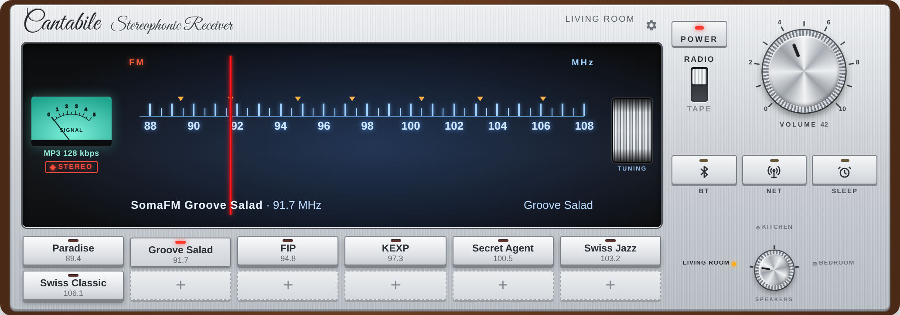
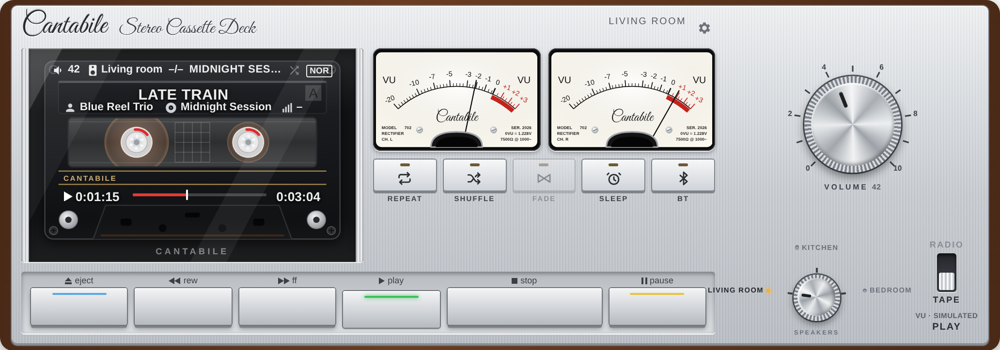
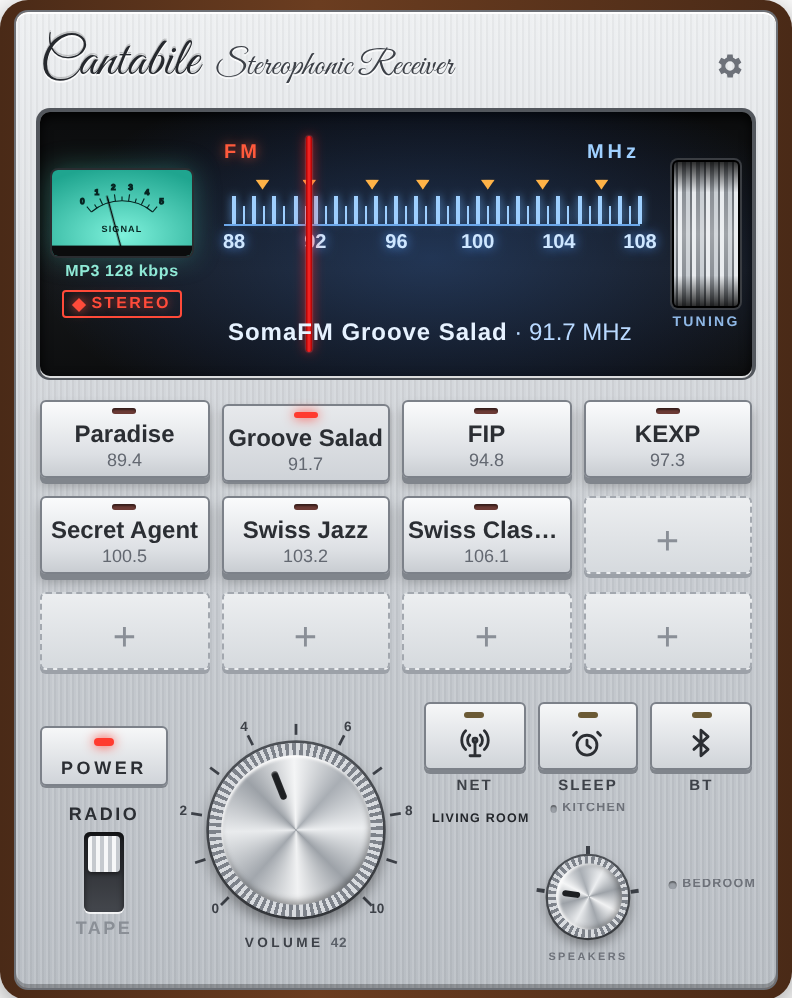

# Cantabile

**70-es évekbeli ezüst rádió és tape deck a Home Assistant vezérlőpultjára.** Adógombok egy FM-skálán, internetes
rádió, tape deck forgó orsókkal és valódi VU-mérőkkel, a saját zenemappád, Deezer és hangvezérlés.

*English: [README.md](README.md)*





<p align="center"></p>

## Mit tud

**Rádió**
- FM-skála mozgó mutatóval, adógombok, hangerő-forgatógomb, hangoló lendkerék.
- **NET**: több ezer internetes adó a [Radio Browser](https://www.radio-browser.info) adatbázisából (hazai, világ,
  műfaj, név szerint). Bármelyik adó gombra tehető.
- SIGNAL-műszer, ami a valódi stream bitrátáját követi.

**Tape deck**
- Kazetta-ablak forgó orsókkal, két mutatós VU-műszer *vagy* fluoreszcens (VFD) kijelző.
- A VU-mérő a **valódi hangszintet** mutatja: az integráció a szerveren ugyanazt a streamet vagy fájlt elemzi.
- REW / PLAY / FF / STOP / PAUSE / EJECT, SHUFFLE, REPEAT (1–5 kör vagy végtelen), FADE (Sonos-áttűnés), SLEEP.
- Kazetta-polc (EJECT):
  - **STREAMING** – a Sonos-kedvencek (listák, albumok);
  - **DEEZER** – a teljes Deezer-kínálat: toplista, keresés, előadó-oldalak (csak Sonoson);
  - **NAS** – a zenemappa (előadó → album), azonnali kereséssel;
  - **TELEFON** – a telefon / gép zenéje: BT-n közvetlenül, más hangszórón átmeneti feltöltéssel (TEMP jelzés, 24 óra múlva törlődik), vagy véglegesen a zenemappába;
  - **SOR** – a lejátszási sor: ugrás, törlés, következőnek, sor végére (Sonos).
- **Sor átrendezése**: a számot a fogantyújánál (⋮⋮) húzd – Sonos, WiiM és BT.
- **Hézagmentes lejátszás**: Sonoson (saját sor) és WiiM-en (a következő számot DLNA-n előre megkapja); BT-n közel hézagmentes.
- **Bemondás**: amíg az Assist (pl. Voice PE) vagy egy TTS-üzenet beszél, a zene lehalkul (Cantabile beállításai).
- **HA-újraindítás után** a Sonoson szóló zenemappás sor a szóló szám után magától folytatódik.
- **DALSZÖVEG**: koppints a kazettán a dal címére (vagy a rádió műsorinfójára, ha dalt mutat) – a szöveg az
  [LRCLIB](https://lrclib.net)-ről jön; a magnón az épp szóló sor kiemelve, a zenével együtt halad.

**Hangszórók**
- Sonos (minden funkció, „Mindkettő” csoporttal együtt), és bármely más lejátszó, ami URL-t tud lejátszani
  (pl. WiiM – az albumot az integráció számonként játssza le).
- **BT**: azon a készüléken szól, amelyiken a kártya nyitva van (fülhallgató, Bluetooth hangszóró).
- Hangszóróváltáskor a zene átkerül, mint egy igazi hangszóró-választón.

**Hangvezérlés**
- Assist-eszköz bármelyik LLM-es beszélgetőügynökhöz (Google Gemini, OpenAI, Anthropic, Ollama…):
  *„Játssz Queent a nappaliban”*, *„Tedd be a Kind of Magic albumot”*, *„Kapcsold be a Jazz FM-et a hálóban”*,
  *„Játszd a Deezerről Adele-t”*. Ami a zenemappában nincs meg, azt a Deezeren keresi.

Az előlapok feliratai mindig angolok, mint egy igazi 70-es évekbeli hifin; a beállítások, az üzenetek és a súgók a Home Assistant nyelvét követik: **magyar** vagy **angol**.

## Feltételek és kompatibilitás

- Home Assistant **2025.1** vagy újabb (fejlesztve és teljesen kipróbálva 2026.10-en; az importok és az API-k 2025.1-en
  ellenőrizve). A nem helyi zenetárak keresőjéhez újabb HA kell (a médiakereső 2026.10-ben megvan, 2025.1-ben még
  nincs); a böngészés és minden más régebbin is megy.
- Legalább egy médialejátszót indítani tudó `media_player`. Hogy mit kapsz, a lejátszón múlik:

| Lejátszó (HA-integráció) | Rádió | Zenemappa | Hézagmentes | Sor fül / húzás | Multiroom | Deezer / Sonos-kedvencek |
|---|---|---|---|---|---|---|
| **Sonos** | ✔ | ✔ | ✔ (Sonos-sor) | ✔ | ✔ (csak Sonos) | ✔ |
| **WiiM**, **LinkPlay** (Arylic, Audio Pro…), **DLNA-renderelők** | ✔ | ✔ | ✔ (DLNA következő szám) | ✔ | – | – |
| **Chromecast / Google Cast**, **Music Assistant**, **Squeezebox**, más *play media*-képes | ✔ | ✔ (számonként) | – | ✔ | – | – |
| **BT** (a készülék, amelyiken a kártya nyitva van) | ✔ | ✔ | közel hézagmentes | ✔ | – | – |

- A lejátszás-indítás nélküli lejátszók (pl. csak távirányítható tévék, Spotify Connect entitások) nem használhatók,
  nem is kerülnek a listába.
- Elhagyható: zenemappa (a HA médiájában NAS-megosztás vagy helyi mappa, vagy más médiaforrás, pl. Jellyfin vagy
  DLNA-médiaszerver – böngészhető, és ahol a HA-ban van médiakereső, kereshető is). A Plex a HA-ban nem médiaforrás, zenemappának nem jó.
- Elhagyható: `ffmpeg` a gazdagépen a valódi VU-jelhez (a Home Assistant OS-ben és a konténerben benne van; nélküle a
  mérők élethű utánzatot mutatnak).
- A Deezer lejátszásához a Sonos appban be kell kötni a Deezert. A Deezer-kereséshez nem kell fiók.

## Telepítés

### HACS (egyéni tároló)
1. HACS → ⋮ → **Egyéni tárolók** → `https://github.com/Gyuszko55/ha-cantabile`, kategória: **Integráció**.
2. Telepítsd a **Cantabile**-t, majd indítsd újra a Home Assistantot.

### Kézzel
Másold a `custom_components/cantabile` mappát a `config/custom_components` mappába, és indítsd újra a Home Assistantot.

## Beállítás

1. **Beállítások → Eszközök és szolgáltatások → Integráció hozzáadása → Cantabile.** Ha hangvezérlést is szeretnél,
   hagyd bekapcsolva az „Assist-eszközt”.
2. Kártya a vezérlőpultra: **Vezérlőpult szerkesztése → Kártya hozzáadása → Cantabile.** A kártyát az integráció
   maga szolgálja ki és regisztrálja, külön erőforrás nem kell.
3. A kártya **⚙** gombjával állítsd be a hangszórókat, az adókat és a zenemappát. A *Mentés* minden vezérlőpult minden
   Cantabile kártyájába beírja, így a tablet és a telefon egyforma marad.

### Hangvezérlés
Az integráció beállítása után nyisd meg a beszélgetőügynök beállításait (pl. **Google Gemini → Beállítás**), és a
*Home Assistant vezérlése* résznél az *Assist* mellett kapcsold be a **Cantabile**-t is.

## Saját hangszórók és források hozzáadása

- **Hangszórók**: a kártya ⚙ → *Hangszórók* → **+ Új hangszóró** → a lejátszó kiválasztása. Csak lejátszani tudó
  lejátszók szerepelnek; a fajtát (Sonos / egyéb) magától beállítja. Hosszú névnél adj *rövid* nevet – az kerül a forgó
  választóra. Két vagy több Sonosnál *Multiroom* állás is lesz (Sonos-csoport).
- **Rádióadók**: ⚙ → keresés a Radio Browserben név szerint, vagy név és stream-cím kézzel. A frekvencia elhagyható
  (csak a skálán való helyét adja). A rádión egy üres **+** helyre vagy a **NET** gombra koppintva több ezer adó közül
  választhatsz, és gombra teheted.
- **Saját zenemappa**: előbb vedd fel a mappát a HA médiájába (Beállítások → Rendszer → Tárhely → *Hálózati tárhely
  hozzáadása* NAS-hoz, típusa *Média*), majd ⚙ → *Zenemappa*: a médiaforrás-útvonal, pl.
  `media-source://media_source/local/Zene` (az oldalsáv **Média** menüjében látod). Elvárt felépítés: előadó / album /
  számok. Jellyfin vagy DLNA-szerver zenetára is jó: a médiaforrás-útvonalát add meg.
- **Streaming**: Sonoson a Sonos-kedvencek (listák, albumok) és a teljes Deezer-kínálat (a Sonos appban bekötött
  Deezer-fiókkal). Ha nem használod, a ⚙-ben rejtsd el a DEEZER fület.
- **Spotify (kísérleti)**: kösd be a Home Assistant **Spotify**-integrációját (saját listák és könyvtár, valamint lejátszás
  Spotify Connect-hangszórón – Premium), és/vagy add meg a Cantabile integráció beállításaiban a Spotify-fejlesztői kulcsot
  (client ID / secret a developer.spotify.com-ról) a katalógus kereséséhez. Sonoson a Sonos appba bekötött Spotify-jal
  szól. Ha egy hangszóró nincs a Spotify Connect-eszközök között, add meg rajta: `spotify_device: <név>`.
- **Tidal (kísérleti)**: Tidal-fejlesztői kulcs (developer.tidal.com) a Cantabile beállításaiban; lejátszás Sonoson, a
  Sonos appba bekötött Tidallal.
- **Zene a telefonodról / gépedről**: TELEFON fül → *Zene választása*. BT-n közvetlenül szól, más hangszórón átmenetileg
  feltöltődik (TEMP a kazettán, 24 óra múlva törlődik).
- **Hang**: LLM-es beszélgetőügynök, a *Cantabile* eszköz bekapcsolva (lásd Hangvezérlés).
- **Bemondások**: az integráció beállításai → bemondó eszközök (Assist-segédállomások, TTS-lejátszók) és a zene hangereje
  bemondás alatt; amíg beszélnek, a Cantabile-hangszórókon a zene halkabban szól.

## Hibaelhárítás

| Mit látsz | Ok / teendő |
|---|---|
| „Custom element doesn't exist” | YAML-módú erőforrások: vedd fel a `/cantabile_static/cantabile-card.js` modult. |
| A ⚙ *Mentés* nem sikerül | Rendszergazda és felületen szerkesztett vezérlőpult kell; YAML-vezérlőpultnál a YAML-t szerkeszd. |
| Egy lejátszó nincs a listában / nem választható | Nincs lejátszás-indítás funkciója. |
| A Deezer nem indul | A Sonos appban kösd be a Deezert, vagy rejtsd el a DEEZER fület. |
| Egy adó Sonoson szól, BT-n nem | Próbáld a stream-cím http-s változatát; a BT-rádió az integráción át megy (`/api/cantabile/stream`). |
| A VU-mérő csak „utánoz” | Nincs `ffmpeg` a gazdagépen, vagy titkosított a stream (Deezer). |
| Üres a zenemappa | Ellenőrizd a ⚙-ben a médiaforrás-útvonalat, és hogy a mappa látszik-e a **Média** menüben. |

## A kártya beállításai (YAML)

```yaml
type: custom:cantabile-card
brand: Cantabile                 # elhagyható
bt: true                         # BT-kimenet ezen a készüléken; false = nincs
speakers:
  - name: Nappali
    entity: media_player.nappali
    mode: sonos                  # sonos | url (sor nélküli lejátszó, pl. WiiM)
  - name: WiiM
    entity: media_player.wiim_mini
    mode: url
stations:                        # elhagyható – a NET-tel többet is találsz
  - name: Petőfi Rádió
    short: Petőfi                # a gomb felirata
    frequency: 94.8              # helye a skálán (87,5–108)
    url: https://icast.connectmedia.hu/4738/mr2.mp3
tape:
  media_folder: media-source://media_source/local/Zene   # előadó/album/szám
  hires_folder: Hi-Res 48kHz     # elhagyható: 48 kHz-es másolatok a Sonosnak (<mappa>/<előadó>/<album [48kHz]>)
  upload_folder: Cantabile       # a TELEFON fül feltöltései ide kerülnek (a zenemappán belül)
  display: vu                    # vu (mutatós műszer) | vfd (fluoreszcens kijelző)
  vu_delay: 0                    # mp; a valódi VU-jelet a hangszóró pufferéhez igazítja
deezer: true                     # false = nincs DEEZER fül
multiroom: true                  # két vagy több Sonosnál „Mindkettő” állás
```

A korábbi magyar kulcsok (`hangszorok`, `adok`, `magno`, `nas` …) is működnek; a ⚙ Mentés abban a formában ír vissza, amiben a beállítás volt.

## Entitások és szolgáltatások

| Entitás | Mire való |
|---|---|
| `number.cantabile_ismetlesszam` | REPEAT: 1–5 kör, 6 = végtelen |
| `sensor.cantabile_alvasidozito` | A futó alvásidőzítők (`timers` attribútum: lejátszó → leállás ideje) |
| `sensor.cantabile_hanggal_inditott_ado` | A hanggal indított internetes adó, hogy a kártya felismerje |

| Szolgáltatás | Mire való |
|---|---|
| `cantabile.play` | Lejátszás név alapján (előadó, album, szám, adó, lista); visszaadja, mi szól és hol |
| `cantabile.play_tracks` / `cantabile.stop_tracks` | Számonkénti lejátszás sor nélküli lejátszón |
| `cantabile.sleep_timer` | Lejátszó leállítása N perc múlva (az utolsó 30 mp-ben lehalkít; Sonoson a saját időzítője) |

## Tudnivalók

- A **valódi VU-jelhez** `ffmpeg` kell a Home Assistant gépén (a Home Assistant OS tartalmazza). A titkosított
  streameket (pl. Deezer) nem lehet elemezni – ilyenkor a mutatók élethű utánzatra váltanak.
- A Sonos legfeljebb 48 kHz-et dekódol: ha a `hires` mappa be van állítva, a hi-res album 48 kHz-es másolata szól
  a Sonoson, a többi lejátszón az eredeti.
- A `..`-ot tartalmazó fájlneveket a Home Assistant média-forrása nem játssza le; a Cantabile kihagyja őket.
- **Hangszórók**: bármely `media_player`, ami tud médiát lejátszani (Sonos, WiiM, Cast, DLNA, Music Assistant, Squeezebox…). A `mode` elhagyható – a Sonost magától felismeri; a lejátszás-indítás nélküli lejátszók nem választhatók. A `short` rövid név a forgókapcsolóra.
- **Adók**: a `frequency` elhagyható; a csak internetes adók a skálán elosztva, WEB felirattal.
- **Deezer**: a Sonos appban bekötött Deezer-fiók kell; ha nincs, rejtsd el a fület (`deezer: false` vagy ⚙).
- **Mentés a ⚙-ben**: rendszergazda és felületen szerkesztett vezérlőpult kell; YAML-vezérlőpultnál a YAML-t szerkeszd (YAML-módú erőforrásoknál a `/cantabile_static/cantabile-card.js` modult is vedd fel). A zenemappába töltés / ürítés is rendszergazdai; az átmeneti feltöltés mindenkinek megy.
- **Biztonság**: a BT-továbbító (`/api/cantabile/stream`) és az átmeneti feltöltés (`/api/cantabile/upload`) bejelentkezett felhasználót kér; a továbbító csak hangot ad tovább, a feltöltési mappa legfeljebb 2 GB, 24 óra után ürül.
- A Radio Browser, a Deezer és az LRCLIB nyilvános adatbázis; a Cantabile csak a keresett szöveget küldi nekik
  (dalszövegnél: előadó, cím, album, hossz). A dalszövegeket csak a memóriában tárolja.

## Licenc

MIT – lásd [LICENSE](LICENSE). A mellékelt *Great Vibes* betűkészlet SIL Open Font License 1.1 alatt áll.
