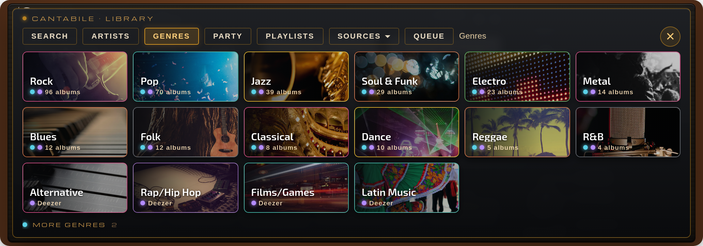
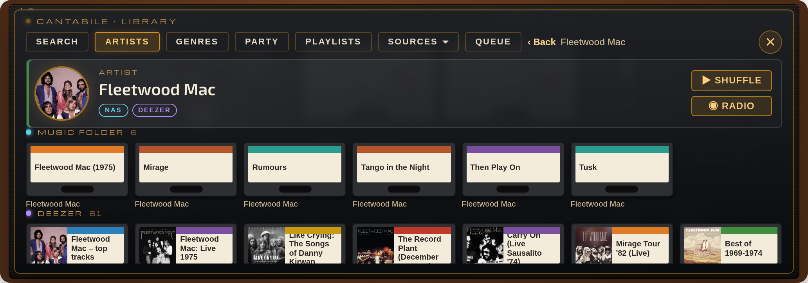
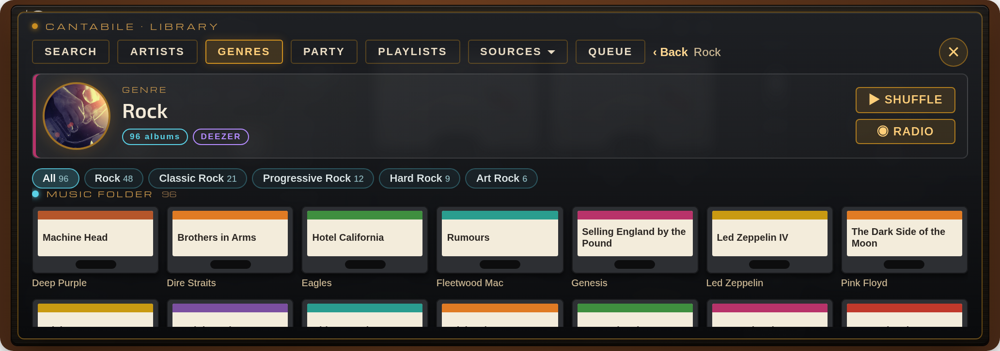
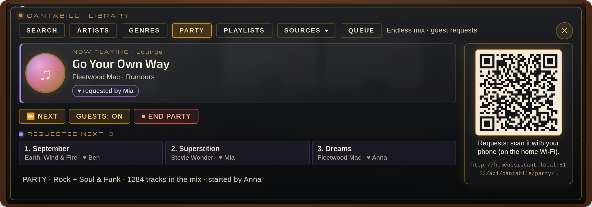
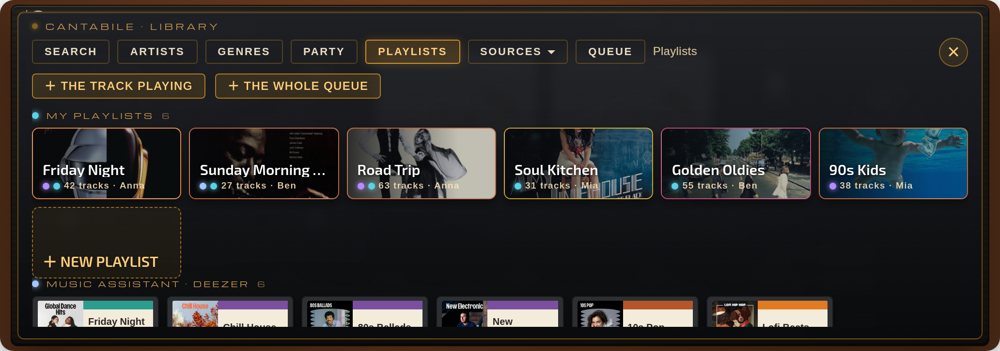
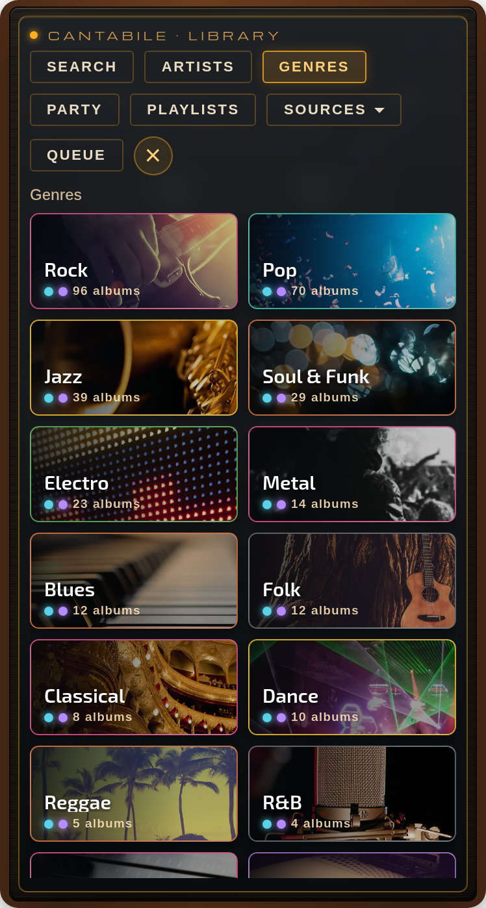
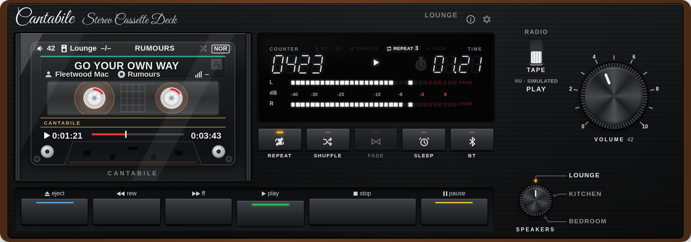

# Cantabile

**Régi hi-fi rádió és tape deck a Home Assistant vezérlőpultjára** – FM-skála adógombokkal, internetes rádió, tape deck
forgó orsókkal és valódi VU-mérőkkel, és egy zenetár, amely egybehozza a saját zenemappádat, a Music Assistantot, a
Deezert, a Spotifyt és a Tidalt: keresés, előadók, műfajok, végtelen party vendégkívánságokkal és listák. Hangvezérléssel,
Cantabile TV-vel, húzott ezüst vagy 90-es évekbeli fekete előlappal.

*English: [README.md](README.md)*


*Minden képen a fekete előlap látszik – finoman húzott fekete, fekete gombokkal (⚙ → Előlap, vagy `finish: black`); alapból húzott ezüst.*

## A zenetár

A tape deck **EJECT** gombja nyitja a zenetárat: füstüveg ablak a magnó fölött – **SEARCH · ARTISTS · GENRES · PARTY ·
PLAYLISTS · SOURCES · QUEUE** (magyar felületen KERESÉS · ELŐADÓK · MŰFAJOK · PARTY · LISTÁK · FORRÁSOK). Aszerint
rendez, amit hallgatni szeretnél, nem aszerint, honnan jön a zene: egy előadó, egy műfaj, egy party vagy egy lista
egybehozza a zenemappát, a Music Assistantot (és a benne bekötött szolgáltatásokat) és a Deezert. Minden elemnél látszik,
hol szól; olyan hangszórón, amelyik nem tudja lejátszani, a kártya megmondja, és felajánl egy megfelelőt.



**KERESÉS** – egy keresés minden forrásban: zenemappa, Music Assistant, Deezer, Spotify, WiiM-presetek, Sonos-kedvencek
és rádióadók. Ugyanaz az album több forrásból egy sor, forráscímkékkel; koppintásra a választott hangszórónak legjobb
forrásból szól. Egy előadó a közös előadó-lapon nyílik. Minden keresőmezőn van 🎤 gomb a **hangalapú kereséshez** (az Assist
beszédfelismerője vagy a böngészőé; a mikrofonhoz https kell).

**ELŐADÓK** – egy A–Z névsor a zenemappából (`előadó/album/szám`) és a Music Assistant könyvtárából, színes forráspöttyökkel
és betű-ugróval; a keresőmező szűri, és a Deezer illő előadóit is mutatja. Az **előadó lapján** fotó, a források,
**▶ KEVERVE** (az előadó összes zenemappás száma keverve, kazettaként, bármelyik hangszórón), **◉ RÁDIÓ** (a Deezer
előadó-rádiója: az előadó és a hozzá hasonlók), alatta a zenemappa albumai, a Music Assistant albumai (a zenemappában
már meglévők nélkül), a Deezer népszerű számai és albumai, és a **HASONLÓ ELŐADÓK**.



**MŰFAJOK** – műfajcsaládok nagy, képes csempéken, a Deezer mintájára (Pop, Rock, Jazz, Metal, Elektronikus…, a Deezer
képeivel). A zenefájlok műfajcímkéi gyakran nagyon aprólékosak – *Art Rock*, *Glam Rock*, *Symphonic Gothic Metal*,
*Neo Soul* –, ezért a Cantabile minden címkét a családjába sorol; ami egyikbe sem illik, a TOVÁBBI MŰFAJOK között van.
Elöl azok a családok, amelyekből a legtöbb saját albumod van. A **műfaj lapján** **▶ KEVERVE** (a műfaj saját albumai
keverve) és **◉ RÁDIÓ** (a Deezer műfaj-rádiója), a családon belüli címkék (Mind · Rock 48 · Classic Rock 21 · …), a saját
albumok, és a Deezerről a műfaj TOPLISTÁJA, LISTÁI, RÁDIÓI és ELŐADÓI. A címkéket albumonként egyszer olvassa be a
háttérben, és megjegyzi; a fül zenemappa nélkül is működik (csak Deezerrel).



**PARTY** – végtelen keverés a zenemappából, a szerveren fut, így akkor is szól, ha a kártyát bezárod. Válaszd az egész
zenetárat vagy egy-több műfajcsaládot, és indítsd a kiválasztott hangszórón (vagy a Sonos multiroom csoporton). Ugyanaz a
szám sokáig nem jön újra, ugyanaz az előadó sosem kétszer egymás után; Sonoson a következő szám mindig a hangszóró saját
sorában vár (szünet nélkül szól). A magnón PARTY kazetta látszik: az FF léptet, a STOP befejezi, a PLAY újraindítja, és
hangszóróváltáskor a party is átköltözik.
**Vendégkívánságok**: a fülön QR-kód látszik. A vendégek az otthoni Wi-Fin beolvassák, és a telefonjukon – Home
Assistant-fiók nélkül – egy oldal nyílik: mi szól most, keresés a zenemappában és *Kérem* gomb (névvel is). Vendégenként
3 kívánság várhat (összesen 30); a kívánságok következnek, sorrendben, *♥ … kérte* jelöléssel. A *VENDÉGEK: KI*
szünetelteti a kívánságokat, és a régi link és QR-kód érvénytelen lesz; a link a party végéig él.



**LISTÁK** – minden lista egy helyen:
- **Saját listák** – a Cantabile sajátjai, a szerveren tárolva, így minden kártyán és minden felhasználónál ugyanazok.
  Egy listában vegyesen lehet zenemappás, Deezeres és Music Assistant-os szám. A **＋ A MOST SZÓLÓ SZÁM** és a
  **＋ A TELJES SOR** meglévő vagy új listába tesz. A lista lapján a számok forráspöttyökkel, lejátszás az elejéről vagy
  bármelyik számtól; a gazdája (vagy egy rendszergazda) átnevezheti, törölheti, és számot vehet ki belőle.
- Vegyes lista lejátszásakor az szól, amit a hangszóró tud: Sonoson a zenemappa és a Deezer (a Sonos sorában),
  Music Assistant-lejátszón a Music Assistant számai, máshol a zenemappa. A kártya megírja, hány szám maradt ki.
- **Music Assistant** – a Music Assistant könyvtárának listái, köztük a Deezer, Spotify, Tidal… kedvenceid, ha ezek
  a Music Assistantban be vannak kötve.
- **Sonos-kedvencek** – a Sonos appban mentett listák.



**FORRÁSOK** – minden forrás külön, mint eddig: STREAMING (Sonos-kedvencek), DEEZER (toplisták, keresés, előadó-oldalak),
SPOTIFY és TIDAL (kísérleti), WIIM (a WiiM presetjei), MA (a Music Assistant könyvtára), NAS (a zenemappa: előadó → album,
azonnali kereséssel) és PHONE (zene a telefonról / számítógépről: BT-n közvetlenül, más hangszórón átmeneti feltöltéssel;
vagy feltöltve a zenemappába). A sor a legutóbb használt forrást nyitja.

**QUEUE** – a szóló sor: ugrás, törlés, következőnek, a sor végére, és átrendezés húzással (⋮⋮) Sonoson, WiiM-en és BT-n;
Music Assistant sornál a szóló és a következő szám.

<p align="center">&nbsp;&nbsp;</p>

## Rádió

- FM-skála mozgó mutatóval, adógombok, hangerő-forgatógomb és **Gyro hangoló lendkerék**.
- **NET**: több ezer internetes adó a [Radio Browser](https://www.radio-browser.info) adatbázisából (hazai, világ, műfaj,
  név szerint).
- A lendkerék egy Radio Browser-lista (a legutóbb használt NET-lista vagy a hazai) következő / előző adójára lép a szóló
  adótól; az adó a pörgetés végén indul. A lista a böngészőben is megmarad, így a kerék a Radio Browser kiesése alatt is megy.
- **Adó mentése**: egy adógombot hosszan nyomva a szóló NET-adót menti oda – egy régebbit is felülírhat, az üzenetben
  *Visszavon* gombbal; üres helyen hosszan nyomva hozzáadja (rendszergazda).
- SIGNAL-műszer, ami a valódi stream bitrátáját követi.

## Tape deck



- Kazettaablak forgó orsókkal, két lengőtekercses VU-mérő *vagy* fluoreszcens (VFD) kijelző.
- A VU-mérők a **valódi hangszintet** mutatják: az integráció ugyanazt a streamet / fájlt elemzi a szerveren.
- REW / PLAY / FF / STOP / PAUSE / EJECT, SHUFFLE, REPEAT (1–5 kör vagy végtelen), FADE (Sonos-áttűnés), SLEEP.
- **Hézagmentes**: Sonoson (saját sor) és WiiM-en (a következő szám előre átadva, DLNA); BT-n közel hézagmentes.
- **DALSZÖVEG**: a kazettán a szám címére koppintva (vagy a rádió műsorsorára) – a szöveg az
  [LRCLIB](https://lrclib.net)-ről jön; a magnón az épp szóló sor kiemelve követi a zenét.
- **Bemondások**: az Assist (pl. Voice PE) vagy egy TTS-üzenet alatt a zene lehalkul (Cantabile beállítások).
- **Home Assistant-újraindítás után** a Sonoson szóló zenemappás sor a szám végén magától folytatódik.

## Hangszórók, bemenetek és hangzás

- Sonos (minden funkcióval, multiroom csoporttal is), és bármelyik más lejátszó, amelyik URL-t tud lejátszani (WiiM,
  LinkPlay, DLNA, Cast, Music Assistant, Squeezebox…). A **BT** azon a készüléken szól, amelyiken a kártya nyitva van.
- **Hangszóróváltáskor a zene megy tovább**, mint egy igazi hangszóróválasztón – kazetta, adó, party, lista, és a Music
  Assistant sora is: másik Music Assistant-lejátszóra, vagy ugyanazon készülék másik lejátszójára (Sonos ↔ a Music Assistant
  lejátszója), zenemappás számnál pedig a Cantabile veszi át ugyanattól a számtól és ponttól.
- Minden hangszórónak van legfeljebb 8 karakteres **kártyaneve** (pl. *Nappali*) a választóra, a fejlécbe és a kazettára;
  a hangvezérlés a teljes nevet használja.
- **INPUT · TONE** – a lenyíló alsó előlap, mint egy régi hi-fi csuklós fedele: a hangszóró saját **bemenetei** (pl. NET ·
  BT IN · LINE IN egy WiiM-en) és **BASS / TREBLE** gombok (−10…+10; Sonos mély / magas, WiiM 10 sávos EQ). Bemenetváltáskor
  a hangerő marad. Ha a hangszóró a saját bemenetéről szól, a magnó ezt mutatja („BT IN”) a telefon küldte címmel; a STOP
  szüneteltet, hangszóróváltáskor szünetel (visszaváltva folytatja).
  > **Bluetooth-párosítás:** a Cantabile nem párosít és nem választ BT-eszközt. A telefont / tabletet a Bluetooth-beállításaiban
  > (vagy a hangszóró appjában) párosítsd; a BT IN csak a hangszóró Bluetooth-bemenetére vált.
- **PAIR** (WiiM): BT IN-re vált, és végigvezet a telefon csatlakoztatásán – a hangszóró Bluetooth-neve, magától bekapcsolt
  párosító mód, Androidon *Megnyitás* gomb a Bluetooth-beállításokhoz, az ismert eszközök és élő „✓ Csatlakozva” állapot.
- **EQ** (WiiM): tízsávos grafikus equalizer, a WiiM beépített hangzásai és saját **profilok**, valamint **AUTO** – profil
  forrásonként és zenemappás műfajonként. Sonoson a panelen **LOUDNESS** van.
- **ⓘ Jelút**: a ⚙ előtti gomb élőben mutatja, honnan jön a hang, mi történik vele, és hol szól (forrás → feldolgozás →
  kimenet, az EQ-val / hangszínnel, és hogy a VU-mérő valódi-e).
- **Üzenetek a lejátszón**: a súgók és hibák füstüveg ablakban jelennek meg a kártyán, aztán elhalványulnak.
- **Hangszóró-foglalás** több felhasználónál – lásd *Tudnivalók*.

## Music Assistant (elhagyható)

Ha a Home Assistantban be van állítva a Music Assistant integráció, a Cantabile a saját forrásai mellett ezt is használja:
az ELŐADÓK névsorában és az előadó-lapokon ott a Music Assistant könyvtára, a LISTÁK között a listái, a FORRÁSOK alatti
**MA** fülön pedig keresés és a könyvtár (albumok, előadók, listák, számok, rádió) borítókkal. A Music Assistant tartalma
Music Assistant-lejátszón szól, a Music Assistant saját sorával.

**Streaming-szolgáltatások a Music Assistanton át**: kösd be a Deezert, Spotifyt, Tidalt, Qobuzt, YouTube Musicot… a Music
Assistantban (*Beállítások → Zeneszolgáltatók*), és a katalógusuk, a kedvenceid és a listáid megjelennek a Cantabile-ban –
kulcs nélkül a Cantabile-ban. A Deezert például az ARL tokennel kell bekötni (a deezer.com böngészősütijéből). A Flow és a
mixek akkor kerülnek a LISTÁK közé, ha a Music Assistantban ♥-vel felveszed őket. Egy Deezer-fiók egyszerre egy helyen szól.

A Cantabile csak a Home Assistant hivatalos Music Assistant-szolgáltatásait használja – saját Music Assistant-kliense nincs.

## TV (Cantabile TV)

A TV-k hangszóróként is választhatók, a szám a képernyőn: **Cast** eszközökön (TV-stick, Android TV box, Nest Hub)
teljes képernyős TV-oldal – előadókép, borító, cím, előadó, album, formátum, a zenét követő equalizer és haladásjelző;
**DLNA** TV-n teljes képernyős álló számkártya. Lásd lent: *TV-lejátszók*.


## Hangvezérlés

Assist-eszköz bármelyik LLM-es beszélgetőügynökhöz (Google Gemini, OpenAI, Anthropic, Ollama…): *„Játssz Queent a
nappaliban”*, *„Tedd be a Kind of Magic albumot”*, *„Kapcsold be a Jazz FM-et a hálóban”*, *„Játszd a Deezerről Adele-t”*.
Ami a zenemappában nincs meg, azt a Deezeren keresi; a Spotifyt és a Tidalt akkor használja, ha azt kéred (Sonoson).

Az előlapok feliratai mindig angolok, mint egy igazi régi hi-fin; a beállítások, az üzenetek és a súgók a Home Assistant
nyelvét követik: **magyar** vagy **angol**.

## Feltételek és kompatibilitás

- Home Assistant **2025.1** vagy újabb (fejlesztve és teljesen kipróbálva 2026.10-en; az importok és az API-k 2025.1-en
  ellenőrizve). A nem helyi zenetárak keresőjéhez újabb HA kell (a médiakereső 2026.10-ben megvan, 2025.1-ben még
  nincs); a böngészés és minden más régebbin is megy.
- Legalább egy médialejátszót indítani tudó `media_player`. Hogy mit kapsz, a lejátszón múlik:

| Lejátszó (HA-integráció) | Rádió | Zenemappa | Hézagmentes | Sor fül / húzás | Multiroom | Deezer / Sonos-kedvencek |
|---|---|---|---|---|---|---|
| **Sonos** | ✔ | ✔ | ✔ (Sonos-sor) | ✔ | ✔ (csak Sonos) | ✔ |
| **WiiM**, **LinkPlay** (Arylic, Audio Pro…), **DLNA-renderelők** | ✔ | ✔ | ✔ (DLNA következő szám) | ✔ | – | – |
| **Chromecast / Google Cast**, **Music Assistant**, **Squeezebox**, más *play media*-képes | ✔ | ✔ (számonként) | – | ✔ | – | – |
| **BT** (a készülék, amelyiken a kártya nyitva van) | ✔ | ✔ | közel hézagmentes | ✔ | – | – |

- A lejátszás-indítás nélküli lejátszók (pl. csak távirányítható tévék, Spotify Connect entitások) nem használhatók,
  nem is kerülnek a listába.
- Elhagyható: zenemappa (a HA médiájában NAS-megosztás vagy helyi mappa, vagy más médiaforrás, pl. Jellyfin vagy
  DLNA-médiaszerver – böngészhető, és ahol a HA-ban van médiakereső, kereshető is). A Plex a HA-ban nem médiaforrás, zenemappának nem jó.
- Elhagyható: `ffmpeg` a gazdagépen a valódi VU-jelhez (a Home Assistant OS-ben és a konténerben benne van; nélküle a
  mérők élethű utánzatot mutatnak).
- A Deezer lejátszásához a Sonos appban be kell kötni a Deezert. A Deezer-kereséshez nem kell fiók.
- Böngésző: friss Chrome / Edge, Safari vagy Firefox – legalább Chrome 105, Safari / iOS 16 vagy Firefox 110 (a régebbiek,
  pl. egy régi fali tablet WebView-ja, elcsúsztathatják a kazetta és a kijelző feliratait). A kártyának saját megjelenése
  van, a Home Assistant témáit nem követi.

## Mit kell telepíteni – és mit hoz magával a Cantabile

### A Cantabile része (nem kell hozzá semmit telepíteni)

| Rész | Megjegyzés |
|---|---|
| A kártya | Az integráció szolgálja ki, és magától felveszi a vezérlőpult-erőforrások közé (YAML-módú erőforrásoknál a `/cantabile_static/cantabile-card.js`-t *module*-ként neked kell felvenni). |
| Betűk | *Arimo* (a kártya Arial-méretű alapbetűje, így a telefon betűbeállítása nem változtat a képen), *Great Vibes*, *Michroma*, *Exo 2* – mellékelve, helyből töltődnek (SIL OFL), a Google-tól semmi nem jön. |
| `async-upnp-client` Python-csomag | A Home Assistant a manifestből telepíti (általában már megvan); a hézagmentes lejátszáshoz kell DLNA / WiiM / LinkPlay lejátszón. |
| `segno` Python-csomag | A Home Assistant a manifestből telepíti; a PARTY vendégoldalának QR-kódját rajzolja. |
| Entitások és szolgáltatások | Ismétlésszám, alvásidőzítő, hanggal indított adó; `cantabile.play`, `cantabile.sleep_timer` … (lásd *Entitások és szolgáltatások*). |
| Assist-eszköz | A *Cantabile* LLM API a hangvezérléshez – a beszélgetőügynök beállításaiban jelenik meg. |
| Ingyenes online források (fiók és kulcs nélkül) | [Radio Browser](https://www.radio-browser.info) (adók), a Deezer nyilvános katalógus-API-ja (keresés), [LRCLIB](https://lrclib.net) (dalszöveg). |

### Amit neked kell telepíteni vagy beállítani

| Mit | Mihez kell | Hogyan |
|---|---|---|
| Home Assistant **2025.1+** | mindenhez | – |
| A hangszóróid integrációja | lejátszás | **Beállítások → Eszközök és szolgáltatások → Integráció hozzáadása**: *Sonos*, *WiiM*, *LinkPlay*, *DLNA Digital Media Renderer*, *Google Cast*, *Music Assistant*, *Squeezebox*… (a Home Assistant saját integrációi, nem a Cantabile részei). |
| `ffmpeg` a gazdagépen | valódi VU-jel (elhagyható) | A Home Assistant OS-ben és a konténer-képben benne van. Python-venv-es (Core) telepítésnél a rendszer csomagkezelőjével tedd fel. Nélküle a mérők utánoznak. |
| Zenemappa | NAS / PHONE fül (elhagyható) | Lásd lent: *Zenetár (NAS) csatolása*. |
| **Cast-os TV** (Cantabile TV, elhagyható) | az élő TV-oldal | Képernyős Cast-eszköz (Chromecast / Google TV, Android TV-doboz vagy -stick, Nest Hub) a **Google Cast** integrációval; a Home Assistant a TV felől **https**-en elérhető (Home Assistant Cloud, vagy saját külső cím tanúsítvánnyal); a `cantabile-tv` irányítópult (lásd *TV-lejátszók*). |
| **DLNA-s TV** (Cantabile TV, elhagyható) | az álló adatlap | DLNA-lejátszós TV a **DLNA Digital Media Renderer** integrációval; a Home Assistant **belső címe** a TV felől elérhető a helyi hálózaton; `ffmpeg` a gazdagépen (ez készíti az adatlap-videókat – nélküle a TV csak a zenét és a borítót kapja); kb. 1,5 GB lemezhely a videótárnak. |
| A Home Assistant **belső címe** | PARTY vendégkívánságok (elhagyható) | *Beállítások → Rendszer → Hálózat*: a vendégek telefonja az otthoni Wi-Fin nyitja meg a QR-kód linkjét. |
| **Music Assistant** | az MA forrás, a listái és a benne bekötött streaming-szolgáltatások (elhagyható) | A Music Assistant bővítmény / szerver és a Home Assistant *Music Assistant* integrációja. |
| Beszélgetőügynök | hangvezérlés (elhagyható) | Pl. *Google Gemini*, *OpenAI*, *Anthropic*, *Ollama*; utána a beállításaiban kapcsold be a **Cantabile**-t (lásd *Hangvezérlés*). |
| Streaming-fiókok / kulcsok | DEEZER, SPOTIFY, TIDAL (elhagyható) | Lásd a következő részt. |

### Streaming-szolgáltatók

| Szolgáltatás | Mi kell hozzá | Mit tud | Hol szól |
|---|---|---|---|
| **Sonos-kedvencek** | A Sonos appban elmentett kedvencek | A mentett listák, albumok, adók a STREAMING fülön, hanggal is | Sonos |
| **Deezer** | A **Sonos appban** bekötött Deezer-előfizetés (*Beállítások → Szolgáltatások és hang → Szolgáltatás hozzáadása*). A kereséshez nem kell fiók. | Toplisták, keresés, előadó-oldalak, albumok, számok; hanggal (*„… a Deezerről”*); ami a zenemappában nincs meg, azt itt keresi | Sonos |
| **Spotify** *(kísérleti)* | 1. A Home Assistant **Spotify** integrációja – saját Spotify fejlesztői appal; átirányítási cím `https://my.home-assistant.io/redirect/oauth`; a lejátszáshoz **Premium**. 2. Elhagyható: Spotify fejlesztői kulcs (client ID / secret) a **Cantabile beállításaiban** a katalógus-kereséshez (nélküle a Spotify-integráció munkamenetét használja). 3. Sonoshoz: a Sonos appban bekötött Spotify. | Keresés, előadó-oldalak, albumok, a saját listáid és könyvtárad; hanggal (*„… a Spotifyról”*) | Sonos (linkkel), bármely **Spotify Connect** hangszóró (pl. WiiM) |
| **Tidal** *(kísérleti)* | Tidal fejlesztői kulcs (developer.tidal.com, client ID / secret) a Cantabile beállításaiban; a Sonos appban bekötött Tidal | Keresés, előadók, albumok, listák; hanggal (*„… a Tidalról”*) | Sonos |

**Mire figyelj**
- A streaming-szolgáltatások magán a hangszórón szólnak, ezért a VU-mérők **utánoznak**, és bitráta / kódolás sem látszik (a hangszóró nem adja meg).
- A Deezer, a Tidal és a Sonos-kedvencek **csak Sonoson** szólnak – más hangszóró választásakor üzenet jön, és a zene a helyén marad.
- **A Spotify fejlesztői appok „fejlesztői módban” futnak**, szigorúbb korlátokkal; a Cantabile ezeken belül működik: típusonként 10 találat, az előadó albumai tízesével, „legnépszerűbb számok” nincs (helyette szűrt keresés), mások listái elindíthatók, de számonként nem listázhatók.
- A Spotify-könyvtárad csak akkor böngészhető, ha épp szól valami a Spotifyon (a Home Assistant Spotify-lejátszójának korlátja); különben a fül megkérdezi, mit keressen.
- Spotify Connect: egy hangszóró hiányozhat a Spotify eszközlistájáról, amíg egyszer nem játszott Spotifyt – nyisd meg rajta a Spotify appot, vagy add meg a hangszórónál: `spotify_device: <ahogy a Spotify mutatja>`.
- A kulcsok és tokenek a szerveren maradnak; a kártya csak olvasó katalógus-hívásokat kér az integrációtól.
- A Tidal-támogatás új, élő fiókkal még nem volt kipróbálva.

### Zenetár (NAS) csatolása

1. A NAS-on oszd meg a zenemappát **SMB**-n (vagy NFS-en) – az olvasási jog elég; írás csak akkor kell, ha a PHONE fülről véglegesen is fel akarsz tölteni.
2. **Beállítások → Rendszer → Tárhely → Hálózati tárhely hozzáadása**: név (pl. `Zene`), felhasználás **Média**, protokoll, szervercím, megosztás neve, felhasználó / jelszó.
3. Nyisd meg az oldalsáv **Média** menüjét: a megosztás a *Saját médiák* alatt jelenik meg. Az útvonala `media-source://media_source/local/<név>`, pl. `media-source://media_source/local/Zene`.
4. A kártyán: **⚙ → Zenemappa** → illeszd be az útvonalat → *Mentés*. A NAS fülön megjelennek az előadók → albumok → számok.

- Elvárt szerkezet: `<előadó>/<album>/<számok>` (MP3, FLAC, AAC/M4A, OGG… – amit a hangszóróid lejátszanak).
- **A Sonos legfeljebb 48 kHz-et játszik**: a hi-res albumok 48 kHz-es másolatait tartsd külön mappában, és add meg a *48 kHz-es másolatok mappáját* (`hires_folder`); Sonoson a Cantabile a másolatot játssza, máshol az eredetit.
- A PHONE-feltöltések a zenemappán belüli *Feltöltések mappájába* kerülnek (`upload_folder`, alapból `Cantabile`) – ehhez írási jog és rendszergazda felhasználó kell.
- Az első keresés végigolvassa a mappát (30 percig tárolja); nagyon nagy zenetárnál ez néhány másodperc.
- Jellyfin- vagy DLNA-szerveres zenetár is jó (a médiaforrás-útvonalával); a Plex nem médiaforrás a Home Assistantban.
- A `..`-t tartalmazó fájlneveket a Home Assistant médiaforrása nem tudja lejátszani, ezeket kihagyja.

## Telepítés

### HACS (egyéni tároló)
1. HACS → ⋮ → **Egyéni tárolók** → `https://github.com/Gyuszko55/ha-cantabile`, kategória: **Integráció**.
2. Telepítsd a **Cantabile**-t, majd indítsd újra a Home Assistantot.

### Kézzel
Másold a `custom_components/cantabile` mappát a `config/custom_components` mappába, és indítsd újra a Home Assistantot.

## Beállítás

1. **Beállítások → Eszközök és szolgáltatások → Integráció hozzáadása → Cantabile.** Ha hangvezérlést is szeretnél,
   hagyd bekapcsolva az „Assist-eszközt”.
2. Kártya a vezérlőpultra: **Vezérlőpult szerkesztése → Kártya hozzáadása → Cantabile** (vagy *Kézi* kártya
   `type: custom:cantabile-card` sorral). A kártyát az integráció maga szolgálja ki és regisztrálja, külön erőforrás nem kell.
   > **A kártya magától nem jelenik meg.** Az integráció létrehozza az entitásokat és elérhetővé teszi a kártyát, de a
   > vezérlőpultra neked kell feltenned. Ha a kártyaválasztóban nincs „Cantabile”, az újraindítás után frissítsd a
   > böngészőt (Ctrl+F5, vagy újratöltés a mobilappban). YAML-módú erőforrásoknál vedd fel a
   > `/cantabile_static/cantabile-card.js` fájlt *module* típusú erőforrásként.
3. A kártya **⚙** gombjával állítsd be a hangszórókat, az adókat és a zenemappát. A *Mentés* minden vezérlőpult minden
   Cantabile kártyájába beírja, így a tablet és a telefon egyforma marad.

### Hangvezérlés
Az integráció beállítása után nyisd meg a beszélgetőügynök beállításait (pl. **Google Gemini → Beállítás**), és a
*Home Assistant vezérlése* résznél az *Assist* mellett kapcsold be a **Cantabile**-t is.

### TV-lejátszók (Cantabile TV)
1. **Beállítások → Eszközök és szolgáltatások → Cantabile → Beállítás → TV-lejátszók**: válaszd ki a TV-ket. A
   Cast-eszköz (*Google Cast* integráció) élő TV-oldalt kap, a DLNA-s TV (*DLNA Digital Media Renderer* integráció)
   álló adatlapot. Mindegyikből egy „Cantabile TV · …” nevű `media_player` lesz.
2. **Csak Cast-os TV-hez**, egyszer: hozd létre a TV-oldalt: **Beállítások → Irányítópultok → Irányítópult hozzáadása →
   Új, üres irányítópult**, cím *Cantabile TV*, cím (URL) **`cantabile-tv`** (az oldalsávban nem kell mutatni); nyisd meg
   → ✎ → ⋮ → *Nyers konfigurációszerkesztő*, és illeszd be:
   ```yaml
   views:
     - title: TV
       path: tv
       panel: true
       cards:
         - type: custom:cantabile-tv
   ```
   A TV ezt az oldalt a Home Assistant Cast-vevőjén át tölti be, ezért a Home Assistantnak a TV felől https-en
   elérhetőnek kell lennie (Home Assistant Cloud vagy saját külső cím).
3. A kártyán: **⚙ → Hangszórók → + Új hangszóró** → a **„Cantabile TV · …”** lejátszót válaszd (ne a TV saját Cast- /
   DLNA-lejátszóját – az csak a hangot kapná; a kártya figyelmeztet is rá).


**Cast-beállítások és követelmények**
- A TV az oldalt a Home Assistant Cast-vevőjén (`cast.home-assistant.io`) át tölti be, ami **https**-en kapcsolódik a Home
  Assistanthoz – Home Assistant Cloud (távoli elérés) vagy saját külső cím érvényes tanúsítvánnyal. Sima `http://` helyi cím
  nem elég.
- Ha magad állítottad be a `http: cors_allowed_origins:` listát, maradjon benne a `https://cast.home-assistant.io` (alapból benne van).
- Ha a vezérlőpult-erőforrásaid YAML-módban vannak, vedd fel a `/cantabile_static/cantabile-card.js`-t *module*
  erőforrásként: a Cast-vevő csak a vezérlőpult erőforrásait tölti be, enélkül a TV-n „Custom element doesn't exist” jelenik meg.
- Android TV / Google TV: a képernyővédőt (és az alvást) állítsd *Soha* értékre, különben a TV kb. 15 perc után elhagyja az oldalt.
- Lejátszás közben más automatizálás ne castoljon ugyanarra a TV-re (az lecserélné az oldalt).
- Ha a TV-n még a Home Assistant fut, de elvesztette a kapcsolatot (pl. újraindítás után), a Cantabile bezárja és újra kiküldi.
- **Tükör**: ha a kártyán egy szóló Cast-os TV-ről másik hangszóróra váltasz (a választóval, a zene átvitelével vagy a „nem játszható itt” üzenet ▶ gombjával), a TV-oldal hang nélkül megmarad, és azt mutatja, ami ott szól – cím, előadó, album, borító, hol szól és honnan jön (pl. „▶ SONOS 2 · DEEZER”), a váltakozó előadóképek és a haladás –, minden új számnál frissül, bárhonnan jön a zene (zenemappa, Deezer, rádió…). Az equalizer a valódi jelszintet követi, ahol a Cantabile elemezni tudja, máshol utánzat. Ha tovább váltasz egy harmadik hangszóróra, a TV is vele megy. A tükör véget ér, ha a TV-n újra lejátszást indítasz, a kártyán kikapcsolod a TV-t, vagy 10 perc csend után; ekkor a TV mehet képernyővédőre.

**DLNA-beállítások és követelmények**
- A TV legyen **bekapcsolva** (a legtöbb TV készenlétben eltűnik a DLNA-ról) – előbb kapcsold be, pl. szkripttel vagy Wake-on-LAN-nal.
- A Home Assistant **belső címe** (Beállítások → Rendszer → Hálózat) legyen elérhető a TV felől; a TV onnan, bejelentkezés
  nélkül tölti le a videót (aláírt, időkorlátos címmel).
- Minden számból rövid életű MP4 készül (álló kép az adatlappal + a zene AAC 256 kbps-ben) a `config/.cache/cantabile_tv`
  mappába – számonként kb. 7 mp, az album következő száma a háttérben készül, a tár ~1,5 GB alatt marad. A rádió élő
  MPEG-TS videóként megy.
- Ezekben a videókban nem lehet tekerni; a következő / előző szám működik.

- A TV a zenemappát, a rádiót, a NET-adókat és a PHONE zenéit játssza; a Deezer, a Tidal és a Sonos-kedvencek Sonoson maradnak.
- DLNA: számonként kb. 7 mp előkészítés (albumnál a következőt a háttérben készíti), a hang AAC 256 kbps, tekerni nem
  lehet; a rádió élő videóként megy. Cast: a hang az eredeti fájl / adás.
- A Cast-os TV-oldal háttere 30 mp-enként lassú áttűnéssel és nagyítással vált: az előadó TheAudioDB-s háttérképei
  (ingyenes, kulcs nélkül), és a Kodi-szokás szerinti képek az album vagy az előadó mappájában (`fanart.jpg`,
  `backdrop2.png`, `extrafanart/…`); ezek nélkül az előadó képe vagy a borító.
- Következő / előző szám a kártyáról, a Home Assistant vezérlőiből és hanggal is.

## Saját hangszórók és források hozzáadása

- **Hangszórók**: a kártya ⚙ → *Hangszórók* → **+ Új hangszóró** → a lejátszó kiválasztása. Csak lejátszani tudó
  lejátszók szerepelnek; a fajtát (Sonos / egyéb) magától beállítja. A *kártyán megjelenő név* (max. 8 karakter, hosszabb
  teljes névnél kötelező) látszik a kártyán – a forgó választón, a fejlécben és a kazettán; a hangvezérlés a teljes nevet használja. Két vagy több Sonosnál *Multiroom* állás is lesz (Sonos-csoport).
- **Rádióadók**: ⚙ → keresés a Radio Browserben név szerint, vagy név és stream-cím kézzel. A frekvencia elhagyható
  (csak a skálán való helyét adja). A rádión egy üres **+** helyre vagy a **NET** gombra koppintva több ezer adó közül
  választhatsz, és gombra teheted.
- **Saját zenemappa**: előbb vedd fel a mappát a HA médiájába (Beállítások → Rendszer → Tárhely → *Hálózati tárhely
  hozzáadása* NAS-hoz, típusa *Média*), majd ⚙ → *Zenemappa*: a médiaforrás-útvonal, pl.
  `media-source://media_source/local/Zene` (az oldalsáv **Média** menüjében látod). Elvárt felépítés: előadó / album /
  számok. Jellyfin vagy DLNA-szerver zenetára is jó: a médiaforrás-útvonalát add meg.
- **Streaming**: Sonoson a Sonos-kedvencek (listák, albumok) és a teljes Deezer-kínálat (a Sonos appban bekötött
  Deezer-fiókkal). Ha nem használod, a ⚙-ben rejtsd el a DEEZER fület.
- **Spotify (kísérleti)**: kösd be a Home Assistant **Spotify**-integrációját (saját listák és könyvtár, valamint lejátszás
  Spotify Connect-hangszórón – Premium), és/vagy add meg a Cantabile integráció beállításaiban a Spotify-fejlesztői kulcsot
  (client ID / secret a developer.spotify.com-ról) a katalógus kereséséhez. Sonoson a Sonos appba bekötött Spotify-jal
  szól. Ha egy hangszóró nincs a Spotify Connect-eszközök között, add meg rajta: `spotify_device: <név>`.
- **Tidal (kísérleti)**: Tidal-fejlesztői kulcs (developer.tidal.com) a Cantabile beállításaiban; lejátszás Sonoson, a
  Sonos appba bekötött Tidallal.
- **Zene a telefonodról / gépedről**: TELEFON fül → *Zene választása*. BT-n közvetlenül szól, más hangszórón átmenetileg
  feltöltődik (TEMP a kazettán, 24 óra múlva törlődik).
- **Hang**: LLM-es beszélgetőügynök, a *Cantabile* eszköz bekapcsolva (lásd Hangvezérlés).
- **Bemondások**: az integráció beállításai → bemondó eszközök (Assist-segédállomások, TTS-lejátszók) és a zene hangereje
  bemondás alatt; amíg beszélnek, a Cantabile-hangszórókon a zene halkabban szól.

## Hibaelhárítás

| Mit látsz | Ok / teendő |
|---|---|
| „Custom element doesn't exist” | YAML-módú erőforrások: vedd fel a `/cantabile_static/cantabile-card.js` modult. |
| A ⚙ *Mentés* nem sikerül | Rendszergazda és felületen szerkesztett vezérlőpult kell; YAML-vezérlőpultnál a YAML-t szerkeszd. |
| Egy lejátszó nincs a listában / nem választható | Nincs lejátszás-indítás funkciója. |
| A Deezer nem indul | A Sonos appban kösd be a Deezert, vagy rejtsd el a DEEZER fület. |
| Egy adó Sonoson szól, BT-n nem | Próbáld a stream-cím http-s változatát; a BT-rádió az integráción át megy (`/api/cantabile/stream`). |
| A VU-mérő csak „utánoz” | Nincs `ffmpeg` a gazdagépen, vagy titkosított a stream (Deezer). |
| Hangvezérlés: az ügynök azt mondja, nem tud zenét indítani, vagy az Assist-hibakeresőben „Tool … not found” | Kapcsold be a *Cantabile*-t az ügynök beállításaiban. Ha a saját utasításod megnevezi az eszközt, a pontos nevét írd – bekapcsolt Assist mellett `cantabile__cantabile_play`. |
| A TV csak a hangot kapja (pl. „Default Media Receiver” a képernyőn) | A kártya a TV saját Cast- / DLNA-lejátszóját használja: állítsd át a hangszórót a „Cantabile TV · …” lejátszóra (a ⚙-ben *Átállítás* gomb). |
| A Cast-os TV-n nem jelenik meg semmi / „dashboard not found” | Hozd létre a `cantabile-tv` irányítópultot a `tv` nézettel (lásd *TV-lejátszók*), és ellenőrizd, hogy a Home Assistant a TV felől https-en elérhető. |
| Üres a zenemappa | Ellenőrizd a ⚙-ben a médiaforrás-útvonalat, és hogy a mappa látszik-e a **Média** menüben. |
| A MŰFAJOK fülön csak Deezer-csempék vannak | A zenefájlokban nincs műfajcímke, vagy még fut az első beolvasás (a fül mutatja a haladást). |
| A PARTY QR-kódja nem nyílik meg a telefonon | A telefon legyen az otthoni Wi-Fin, és legyen beállítva a Home Assistant *belső címe* (Beállítások → Rendszer → Hálózat). |
| Egy lista csak néhány számot játszik | Minden hangszóró azt játssza, amit tud: Sonos a zenemappát és a Deezert, Music Assistant-lejátszó az MA-számokat, a többi a zenemappát. |

## A kártya beállításai (YAML)

A kártyaszerkesztő (✎ a vezérlőpulton) YAML nélkül beállítja a hangszórókat, a márkanevet, az előlapot, a kijelzőt, a zenemappát és az FM-sávot; az adókat, a hangszórók nevét és a kártyán megjelenő rövid nevet a kártya saját ⚙ gombjával lehet megadni. A teljes YAML:

```yaml
type: custom:cantabile-card
brand: Cantabile                 # elhagyható
finish: silver                   # silver (ezüst húzott alumínium) | black (90-es évek fekete húzott előlap)
fm_band: jp                      # elhagyható: jp = japán FM-sáv, 76–95 MHz (magától, ha a HA-ban Japán az ország)
bt: true                         # BT-kimenet ezen a készüléken; false = nincs
speakers:
  - name: Nappali                      # teljes név – a hangvezérlés ezt használja
    short: Sonos 1               # a kártyán megjelenő név, max. 8 karakter (hosszabb névnél kötelező)
    entity: media_player.nappali
    mode: sonos                  # sonos | url (sor nélküli lejátszó, pl. WiiM)
  - name: WiiM
    entity: media_player.wiim_mini
    mode: url
stations:                        # elhagyható – a NET-tel többet is találsz
  - name: Petőfi Rádió
    short: Petőfi                # a gomb felirata
    frequency: 94.8              # helye a skálán (87,5–108; Japánban 76–95)
    url: https://icast.connectmedia.hu/4738/mr2.mp3
tape:
  media_folder: media-source://media_source/local/Zene   # előadó/album/szám
  hires_folder: Hi-Res 48kHz     # elhagyható: 48 kHz-es másolatok a Sonosnak (<mappa>/<előadó>/<album [48kHz]>)
  upload_folder: Cantabile       # a TELEFON fül feltöltései ide kerülnek (a zenemappán belül)
  display: vu                    # vu (mutatós műszer) | vfd (fluoreszcens kijelző)
  vu_delay: 0                    # mp; a valódi VU-jelet a hangszóró pufferéhez igazítja
deezer: true                     # false = nincs DEEZER fül
multiroom: true                  # két vagy több Sonosnál „Mindkettő” állás
```

A korábbi magyar kulcsok (`hangszorok`, `adok`, `magno`, `nas` …) is működnek; a ⚙ Mentés abban a formában ír vissza, amiben a beállítás volt.

## Entitások és szolgáltatások

| Entitás | Mire való |
|---|---|
| `number.cantabile_ismetlesszam` | REPEAT: 1–5 kör, 6 = végtelen |
| `sensor.cantabile_alvasidozito` | A futó alvásidőzítők (`timers` attribútum: lejátszó → leállás ideje) |
| `sensor.cantabile_hanggal_inditott_ado` | A hanggal indított internetes adó, hogy a kártya felismerje |

| Szolgáltatás | Mire való |
|---|---|
| `cantabile.play` | Lejátszás név alapján (előadó, album, szám, adó, lista); visszaadja, mi szól és hol |
| `cantabile.play_tracks` / `cantabile.stop_tracks` | Számonkénti lejátszás sor nélküli lejátszón |
| `cantabile.sleep_timer` | Lejátszó leállítása N perc múlva (az utolsó 30 mp-ben lehalkít; Sonoson a saját időzítője) |

## Tudnivalók

- A **valódi VU-jelhez** `ffmpeg` kell a Home Assistant gépén (a Home Assistant OS tartalmazza). A titkosított
  streameket (pl. Deezer) nem lehet elemezni – ilyenkor a mutatók élethű utánzatra váltanak.
- A Sonos legfeljebb 48 kHz-et dekódol: ha a `hires` mappa be van állítva, a hi-res album 48 kHz-es másolata szól
  a Sonoson, a többi lejátszón az eredeti.
- A `..`-ot tartalmazó fájlneveket a Home Assistant média-forrása nem játssza le; a Cantabile kihagyja őket.
- **Hangszórók**: bármely `media_player`, ami tud médiát lejátszani (Sonos, WiiM, Cast, DLNA, Music Assistant, Squeezebox…). A `mode` elhagyható – a Sonost magától felismeri; a lejátszás-indítás nélküli lejátszók nem választhatók. A `short` rövid név a forgókapcsolóra.
- **Adók**: a `frequency` elhagyható; a csak internetes adók a skálán elosztva, WEB felirattal.
- **Deezer**: a Sonos appban bekötött Deezer-fiók kell; ha nincs, rejtsd el a fület (`deezer: false` vagy ⚙).
- **Mentés a ⚙-ben**: rendszergazda és felületen szerkesztett vezérlőpult kell; YAML-vezérlőpultnál a YAML-t szerkeszd (YAML-módú erőforrásoknál a `/cantabile_static/cantabile-card.js` modult is vedd fel). A zenemappába töltés / ürítés is rendszergazdai; az átmeneti feltöltés mindenkinek megy.
- **Hangszóró-foglalás (több felhasználó)**: a hangszóró azé a felhasználóé, aki egy Cantabile kártyáról (vagy
  bejelentkezett felhasználóként hanggal) zenét indított rajta. A többi felhasználó kártyáján a választóban halvány,
  a lámpája lassan villog, és nem választható ki; a parancsok sem mennek rá, a kártya megmondja, ki használja
  („A(z) Nappali foglalt: Kata · telefon használja.”). Ugyanaz a felhasználó a másik készülékéről folytathatja.
  A foglalás STOP-ra, POWER-re vagy másik hangszóróra váltáskor szűnik meg, vagy ha a hangszóró 5 perce nem szól
  (szünet, áll, ki van kapcsolva). Rendszergazda az üzenet **Átveszem** gombjával átveheti; az előző felhasználó
  kártyája erről üzenetet kap. A hangparancs (`cantabile.play`, az Assist-eszköz) nem veszi el a más által használt
  hangszórót. A BT kimenet soha nem foglalt. A foglalás a memóriában van: HA-újraindítás után minden hangszóró szabad.
- **Biztonság**: a BT-továbbító (`/api/cantabile/stream`) és az átmeneti feltöltés (`/api/cantabile/upload`) bejelentkezett felhasználót kér; a továbbító csak hangot ad tovább, a feltöltési mappa legfeljebb 2 GB, 24 óra után ürül.
  A PARTY vendégoldala (`/api/cantabile/party/<token>`) nem kér bejelentkezést: a véletlen link védi, csak a party alatt (és bekapcsolt vendégkívánságoknál) él, és csak azt tudja, hogy mutassa, mi szól, keressen a zenemappában és kívánságot vegyen fel (vendégenként 3, összesen 30). A *VENDÉGEK: KI* a régi linket érvényteleníti.
- **A listák és a party** a szerveren élnek: a listák a Home Assistant tárolójában (`cantabile_listak`), a party Home Assistant-újraindításkor véget ér.
- A Radio Browser, a Deezer és az LRCLIB nyilvános adatbázis; a Cantabile csak a keresett szöveget küldi nekik
  (dalszövegnél: előadó, cím, album, hossz). A dalszövegeket csak a memóriában tárolja.

## Licenc

MIT – lásd [LICENSE](LICENSE). A mellékelt *Arimo*, *Great Vibes*, *Michroma* és *Exo 2* betűkészlet SIL Open Font License 1.1 alatt áll (lásd az OFL-*.txt fájlokat a `www` és a `fonts` mappában).
