# Cantabile

**An old hi-fi radio and cassette deck for your Home Assistant dashboard** – an FM dial with preset buttons, internet
radio, a cassette deck with turning reels and real VU meters, and a music library that brings your own music folder,
Music Assistant, Deezer, Spotify and Tidal together: search, artists, genres, an endless party mix with guest requests,
and playlists. With voice control, Cantabile TV and a brushed silver or nineties black front panel.

*Magyar leírás: [README.hu.md](README.hu.md)*

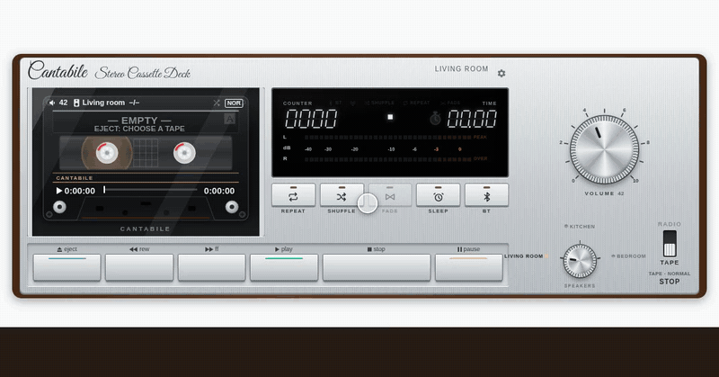

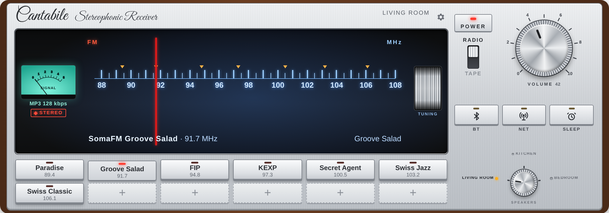

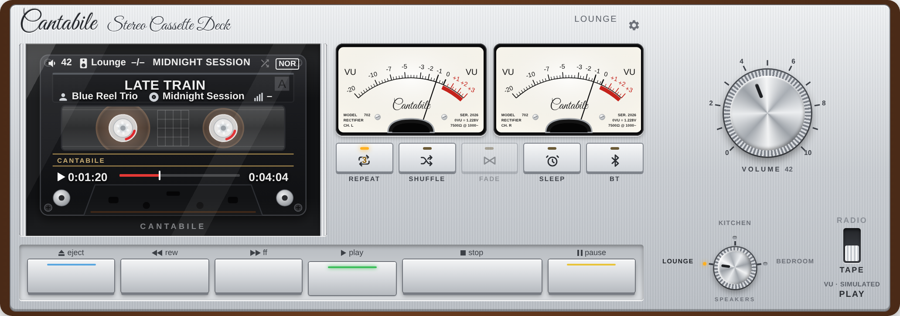

*All pictures show the black front panel – finely brushed black with black keys and knobs (⚙ → Front panel, or `finish: black`); the default is brushed silver.*

## The library

**EJECT** on the tape deck opens the library: a smoked-glass window over the deck – **SEARCH · ARTISTS · GENRES · PARTY ·
PLAYLISTS · SOURCES · QUEUE**. It is organised by what you want to hear, not by where the music comes from: an artist,
a genre, a party or a playlist brings together the music folder, Music Assistant (and the services linked in it) and
Deezer. Each item shows where it plays; on a speaker that can't play it, the card says so and offers one that can.

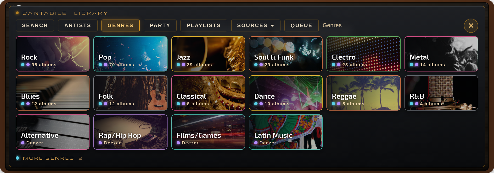

**SEARCH** – one search over every source: music folder, Music Assistant, Deezer, Spotify, WiiM presets, Sonos
favourites and radio stations. The same album from several sources is one row with source tags, and a tap plays it from
the best source for the chosen speaker. An artist opens the shared artist page. Every search box has a 🎤 button for
**voice search** (the speech-to-text of your Assist pipeline, or the browser's own; the microphone needs https).

**ARTISTS** – one A–Z list from the music folder (`artist/album/track`) and the Music Assistant library, with coloured
source dots and a letter index; typing filters it and also lists matching Deezer artists. The **artist page** has a
portrait, the sources, **▶ SHUFFLE** (all the artist's tracks from the music folder, shuffled, as a cassette that plays
on any speaker), **◉ RADIO** (Deezer artist radio: the artist and similar ones), then the music-folder albums, the
Music Assistant albums not already in the folder, the Deezer top tracks and albums, and **SIMILAR ARTISTS**.

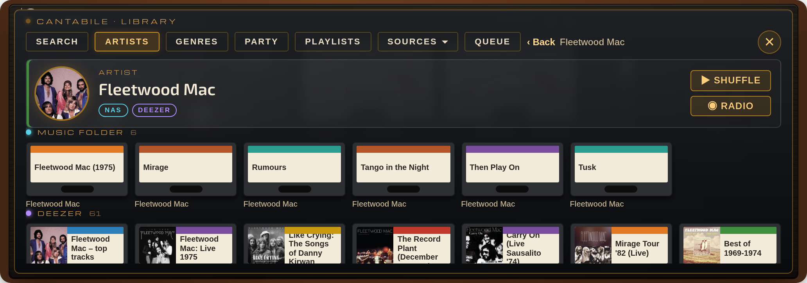

**GENRES** – genre families as big picture tiles, the way Deezer shows them (Pop, Rock, Jazz, Metal, Electro…, with
Deezer's pictures). Your music files' genre tags are often very fine – *Art Rock*, *Glam Rock*, *Symphonic Gothic Metal*,
*Neo Soul* – so Cantabile puts each tag into its family; what fits none is listed under MORE GENRES. The families with
the most albums of your own come first. A **genre page** has **▶ SHUFFLE** (the genre's own albums, shuffled) and
**◉ RADIO** (Deezer genre radio), chips for the tags inside the family (All · Rock 48 · Classic Rock 21 · …), your
albums, and from Deezer the genre's CHART, PLAYLISTS, RADIOS and ARTISTS. The tags are read once per album in the
background and kept; the tab works without a music folder too (Deezer only).

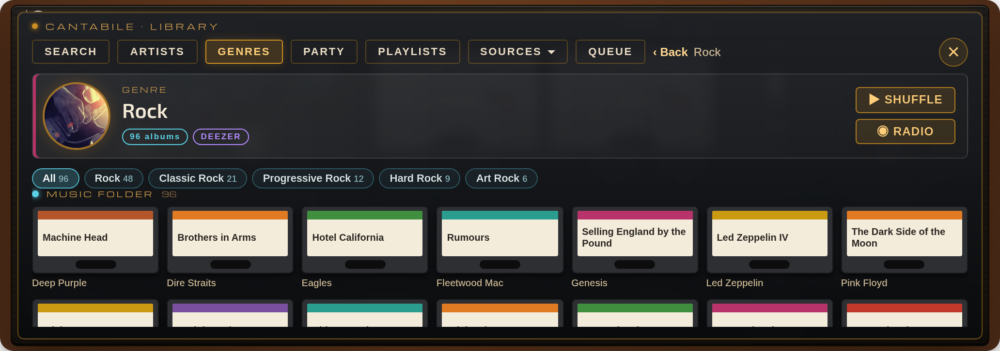

**PARTY** – an endless mix from the music folder that runs on the server, so it keeps playing when the card is closed.
Pick the whole library or one or more genre families and start it on the selected speaker (or the Sonos multiroom
group). The same track doesn't come back for a long time, the same artist never twice in a row; on Sonos the next
track always waits in the speaker's own queue (no gap). The tape shows a PARTY cassette: FF skips, STOP ends it, PLAY
restarts it, and switching speakers takes the party along.
**Guest requests**: the tab shows a QR code. Guests scan it on the home Wi-Fi and get a page on their phone – no
Home Assistant account – with what plays now, a search in the music folder and a *Request* button (with an optional
name). Each guest can have 3 requests waiting (30 in all); requests play next, in order, marked *♥ … requested it*.
*GUESTS: OFF* pauses requests and makes the old link and QR code invalid; the link ends with the party.

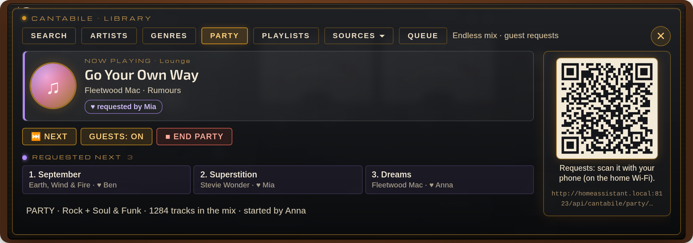

**PLAYLISTS** – every playlist in one place:
- **My playlists** – Cantabile's own, stored on the server, so every card and every user sees the same ones. Tracks can
  come from the music folder, Deezer and Music Assistant mixed. **＋ THE TRACK PLAYING** and **＋ THE WHOLE QUEUE** add
  to an existing playlist or a new one. A playlist's page lists its tracks with source dots and plays from the top or
  from any track; its owner (or an admin) can rename it, delete it and remove tracks.
- Playing a mixed playlist plays what the speaker can: on Sonos the music folder and Deezer (in the Sonos queue), on a
  Music Assistant player the Music Assistant tracks, elsewhere the music folder. The card says how many were skipped.
- **Music Assistant** – the playlists in the Music Assistant library, including your Deezer, Spotify, Tidal… favourites
  when those services are linked in Music Assistant.
- **Sonos favourites** – the playlists saved in the Sonos app.

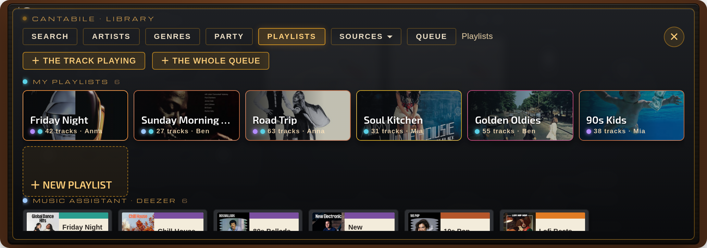

**SOURCES** – each source on its own, as before: STREAMING (Sonos favourites), DEEZER (**MY LIBRARY** – your Deezer
playlists, albums and artists – then charts, search, artist pages), SPOTIFY (**MY LIBRARY** from the Home Assistant Spotify
account, search) and TIDAL (experimental), WIIM (the WiiM's presets – Deezer and radio presets play on any speaker), MA (the Music Assistant library), NAS (the music folder:
artist → album, with instant search) and PHONE (music from the phone or computer: on BT directly, on other speakers
through a temporary upload; or uploaded to the music folder). The row reopens the source used last.

**QUEUE** – the current queue: jump, remove, play next, add to the end, and reorder by dragging (⋮⋮) on Sonos, WiiM and
BT; for a Music Assistant queue the tracks around the playing one (with covers, following track changes), and the
cassette counter shows which track of the list plays (e.g. 012/300).

<p align="center">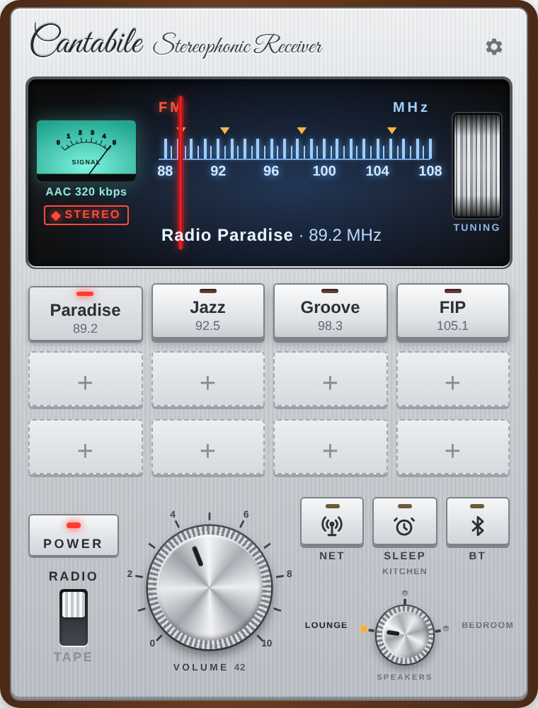&nbsp;&nbsp;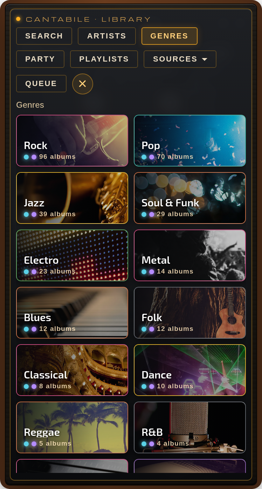</p>

## Radio

- FM-style glass dial with a moving pointer, preset buttons, a volume knob and a **Gyro tuning wheel**.
- **NET**: thousands of internet stations from the [Radio Browser](https://www.radio-browser.info) directory (your
  country, worldwide, by genre, by name).
- The tuning wheel steps to the next / previous station of a Radio Browser list (the NET list you last played from, or
  your country's), starting from the station that plays; the station starts when you stop turning. The list is also
  kept in the browser, so the wheel works while Radio Browser is down.
- **Save a station**: a long press on a preset button saves the NET station that plays there – also over an older one,
  with *Undo* in the message; a long press on an empty slot adds it (admins).
- SIGNAL meter that follows the real stream bitrate.

## Cassette deck

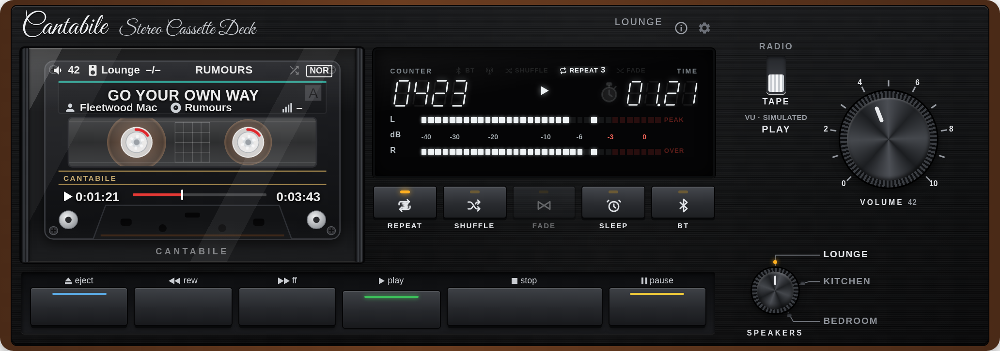

- Cassette window with turning reels, two moving-coil VU meters *or* a fluorescent (VFD) display.
- The VU meters show the **real audio level**: the integration analyses the same stream or file on the server.
- REW / PLAY / FF / STOP / PAUSE / EJECT, SHUFFLE, REPEAT (1–5 rounds or endless), FADE (Sonos crossfade), SLEEP.
- **Gapless**: Sonos (its own queue) and WiiM (the next track is handed over in advance via DLNA); near-gapless on BT.
- **LYRICS**: tap the song title on the cassette (or the radio's now-playing line) – the lyrics come from
  [LRCLIB](https://lrclib.net); on the tape the current line is highlighted and follows the music (plain lyrics scroll
  along with the song). **WRONG LYRICS** discards lyrics that don't belong to the song and looks for others at once; the
  rejected ones don't come back.
- **Announcements**: music is turned down while Assist (e.g. Voice PE) or a TTS message speaks (Cantabile options).
- **After a Home Assistant restart** a playing music-folder queue on Sonos continues by itself after the current track.

## Speakers, inputs and sound

- Sonos (full feature set, including multiroom grouping), and any other media player that can play a URL (WiiM,
  LinkPlay, DLNA, Cast, Music Assistant, Squeezebox…). **BT** plays on the device the card is open on.
- **Switching speakers carries the music over**, like a real speaker selector – a tape, a station, a party, a playlist,
  and a Music Assistant queue: to another Music Assistant player, or to the same device's other player (Sonos ↔ its
  Music Assistant player), or, for music-folder tracks, Cantabile takes over from the same track and position.
  A Music Assistant queue moved to a Cantabile TV plays from the music folder on the TV page if the tracks are there,
  otherwise on the TV's own Music Assistant player (sound only; long Deezer lists of 40+ tracks always go there, in
  full). The card checks that the TV keeps playing – a DLNA TV (e.g. Samsung) doesn't play Music Assistant, so the
  music goes back to the old speaker with a message. While Music Assistant plays, next / previous / pause / stop go to it,
  and the tape's timeline and synced lyrics follow it too (the device's own player may report a stale position).
- **Sonos ↔ WiiM order**: Sonos plays Deezer favourites newest first, Deezer and the WiiM's own Deezer oldest first. When
  the WiiM would continue with a different track than the Sonos, its own Deezer is skipped and the list goes on through
  Music Assistant's Deezer in the Sonos order. A list playing on the WiiM's own Deezer can be moved on too. Splitting a
  Sonos group puts the speaker left alone back where the group was (if the group played from its queue).
- Each speaker has a **card name** of up to 8 characters (e.g. *Lounge*) for the selector, the header and the cassette;
  voice control keeps using the full name.
- **INPUT · TONE** – the flip-down lower panel, like the hinged flap of an old hi-fi: the speaker's own **inputs**
  (e.g. NET · BT IN · LINE IN on a WiiM) and **BASS / TREBLE** knobs (−10…+10; Sonos bass / treble, WiiM 10-band EQ).
  The volume is kept when the input changes. While a speaker plays from its own input the tape shows it (“BT IN”) with
  the title the phone sends; STOP pauses, and switching speakers pauses it (switching back resumes).
  **AirPlay**: when a phone sends AirPlay to a Sonos or WiiM, the tape shows AIRPLAY with the title and artist from the
  phone; STOP pauses (the phone stops too). It can't be moved to another speaker from the card – choose the other speaker
  in the phone's AirPlay menu.
  > **Bluetooth pairing:** Cantabile doesn't pair or pick the Bluetooth device. Pair your phone / tablet with the speaker
  > in its Bluetooth settings (or the speaker's app); BT IN only switches the speaker to its Bluetooth input.
- **PAIR** (WiiM): switches to BT IN and guides you through connecting a phone – the speaker's Bluetooth name, pairing
  mode switched on by itself, an *Open* button for the Bluetooth settings on Android, the known devices and a live
  “✓ Connected” status.
- **EQ** (WiiM): a ten-band graphic equalizer, the WiiM's built-in sounds and your own **profiles**, plus **AUTO** – a
  profile per source and per music-folder genre. On Sonos the panel has **LOUDNESS**.
- **ⓘ Signal path**: the button before ⚙ shows, live, where the sound comes from, what happens to it and where it plays
  (source → processing → output, with the EQ / tone and whether the VU meter is real).
- **Messages on the player**: hints and errors appear in a smoked-glass window on the card, then fade out.
- **Version label**: the card's version (e.g. `2.7.0`) shows in small, faint type in the bottom-right corner of the
  radio and the deck – handy for bug reports.
- **Decision log**: speaker switches, the route taken, fallbacks, every message and every bounce back to the old speaker
  are logged in Home Assistant – the last 300 entries via websocket `cantabile/log/get`; warnings and errors also go to
  the HA log (`custom_components.cantabile.kartya`). Handy when the selector “bounced back without a word”.
- **Speaker lock** for several users – see *Notes*.

## Route matrix – what plays where

Since 2.7, Cantabile keeps a **route matrix**: every source (music folder, radio, Deezer, Spotify, Tidal, WiiM presets,
Sonos favourites, the Music Assistant library, phone, AirPlay, PARTY, own playlists) × every speaker. Each cell lists the
routes in order – e.g. on a WiiM a Deezer album goes first to the WiiM's own Deezer (lossless), then to Music Assistant's
Deezer, then to the same tracks from your music folder – each with its conditions (a Deezer account in the WiiM, a Music
Assistant player on the device, the music folder set…) and where it plays (the device's own player, a TV page or its
Music Assistant player; directly or by substitution). The matrix is built from your setup and Home Assistant, kept in
storage and refreshed at start-up, when players or dashboards change, hourly and on request.

- **The card plays from the matrix**: the first live route of the cell starts, no questions asked; **OTHER ROUTE** in
  the message offers the cell's other live routes. If a route doesn't play, it counts as not playing for an hour and the
  next route starts right away. Messages, switch buttons and source chips (“plays on: …”) come from the matrix too.
- **Everything everywhere**: Sonos favourites play on every speaker – off a Sonos the favourite's content plays (a Deezer
  album / playlist, a Spotify item or a radio station), and the STREAMING tab says so; **BT** (the browser) plays Deezer,
  Spotify and Music Assistant tracks from your music folder, where it has them.
- **ROUTE MATRIX view**: ⓘ (signal path) → **ROUTE MATRIX** shows the matrix on the card – green direct, orange
  substitution, amber can't be checked, grey doesn't play, with the first live route's short name in each cell. Tap a cell
  for its routes with their conditions (✓ / ✗ / ?) and where the picture appears on a TV. **ALL DEVICES** adds the
  speakers that aren't on the card, **REFRESH** rebuilds the matrix, **CLEAR MARKS** forgets the “didn't play” marks.
- **Route recipes** (2.7.0): every route also carries its recipe – the command and its parameters, the target player,
  whether it can start at a position (seconds / track index / no), whether it can be handed over to another player, and
  per content format whether it plays directly or transcoded (FLAC → MP3 320k). For now this is data only: the card
  starts routes as before.
- **Learned traits are kept**: e.g. a TV whose page can't open FLAC (see *TV*) is remembered in the matrix store and gets
  MP3 from the first track, also after a restart.
- Websocket (for the curious): `cantabile/matrix` (`refresh: true` rebuilds it), `cantabile/matrix/reset` clears the
  marks – with `learned: true` it also forgets the learned traits. An expired “didn't play” mark clears at once, and a
  damaged stored matrix doesn't stop the integration from starting (the matrix is rebuilt).

## Music Assistant (optional)

If the Music Assistant integration is set up in Home Assistant, Cantabile uses it as a source next to its own:
the ARTISTS list and the artist pages include the Music Assistant library, PLAYLISTS lists its playlists, and the
**MA** tab under SOURCES has search and the library (albums, artists, playlists, tracks, radio) with covers.
Music Assistant content plays on Music Assistant players with Music Assistant's own queue.

**Streaming services through Music Assistant**: link Deezer, Spotify, Tidal, Qobuz, YouTube Music… in Music Assistant
(*Settings → Music providers*) and their catalogue, your favourites and your playlists appear in Cantabile – without
keys in Cantabile. Deezer, for example, is linked with its ARL token (copied from the deezer.com browser cookie).
Flow and mixes appear in PLAYLISTS once you ♥ them in Music Assistant. Note that a Deezer account plays in one place at
a time.

Cantabile only uses Home Assistant's official Music Assistant services – it has no Music Assistant client of its own.

## TV (Cantabile TV)

TVs become speakers, with the track on the screen: on **Cast** devices (TV sticks, Android TV boxes, Nest Hub) a
full-screen TV page – the cover, title, artist, album, format, artist pictures in the background, a progress bar and the
**lyrics running along** at the bottom; on **DLNA** TVs a full-screen still track card (mid-track a live video that
starts right at the position). Looks: **cover** (default), **spinning vinyl** with a circular spectrum, or the equaliser
– chosen in ⚙ → *TV look* or with the `select` / `switch` entities below. When a TV is switched to another speaker it
keeps showing that speaker's track (mirror), also after a Home Assistant restart – also when the TV played on its own
Music Assistant player (the Cantabile TV page takes its place). Any other **mirror is sent by hand**: **SEND TO TV** in
the card's TV window casts the TV page (if it isn't there yet) and the TV silently shows that speaker; the room's TVs
come first, with several TVs the card asks which one; **MIRROR OFF** ends it. A mirror you sent follows the music when
you move it to another speaker. When Music Assistant plays on the mirrored speaker, the mirror – and the card's TV window –
shows Music Assistant's title, position and cover (the device's own player, e.g. a WiiM, can show an earlier track). A mirror never starts by itself (a DLNA TV can't mirror). Some Cast receivers can't open certain FLAC files
(typically ones with a large embedded cover and no seek table): Cantabile then plays the same track from the same point
as MP3 (320 kbit/s, converted on the fly) and remembers that TV – from then on, also after a restart, FLAC goes to it as
MP3 from the first track. Only a real format error teaches this (not a NAS hiccup or an expired link), and you can seek
inside a transcoded track; started or sought mid-way, it still shows its full length.

The **TV button** on the card (before ⓘ) opens the same page in a small window over the deck for the selected speaker;
it follows track and speaker changes and closes by itself 5 seconds after the music stops. **⛶ FULL SCREEN** in the
window's bottom bar shows it across the whole screen – handy on a tablet or a notebook (the browser goes full screen;
on Android tablets in landscape); a tap or Esc goes back. In full screen a **volume slider** slides out on the left
edge, like in video players: tap the left edge (or move the mouse there), drag up / down, or use the mouse wheel and
↑ / ↓.

Lyrics come from [LRCLIB](https://lrclib.net) (timed, karaoke-style highlight, with a 🎤 KARAOKE tag); when it is down
or doesn't have the track, from [lyrics.ovh](https://lyrics.ovh) (plain text). Without lyrics, the reason runs along in
their place. Found lyrics are **kept**: beside the track as an `.lrc` file for the music folder (Kodi and other players
read it too), and on the Home Assistant server (`.cache/cantabile_dalszoveg/Artist/Title.lrc`) for streamed tracks
(Deezer, Spotify, Music Assistant, radio). A background job collects timed lyrics for the whole music folder at a
gentle pace and replaces plain lyrics with timed ones when they appear. See *TV players* below.

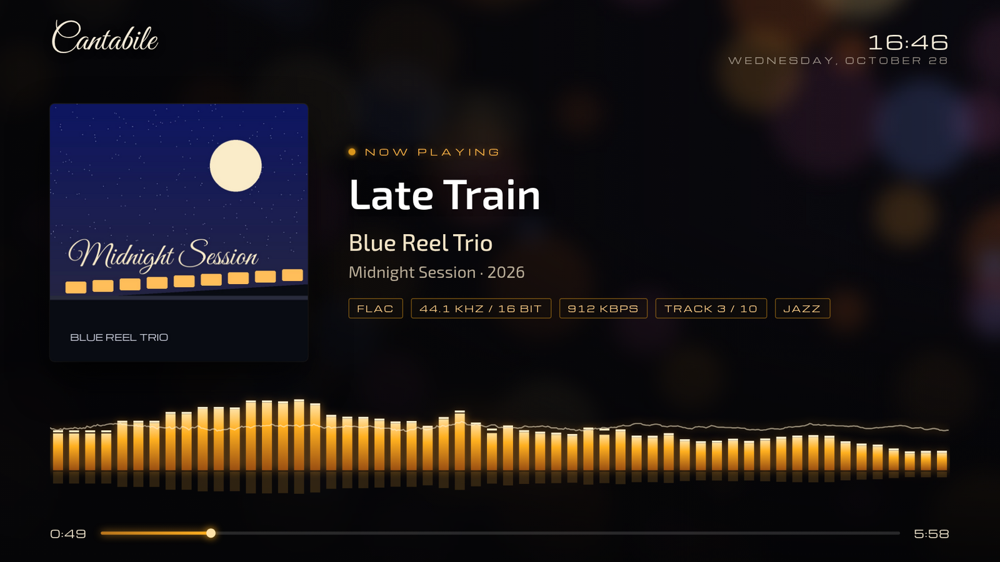

## Voice

An Assist tool for any LLM conversation agent (Google Gemini, OpenAI, Anthropic, Ollama…): *“Play Queen in the living
room”*, *“Put on the Kind of Magic album”*, *“Turn on Jazz FM in the bedroom”*, *“Play Adele from Deezer”*. Anything not
in your music folder is looked up on Deezer; Spotify and Tidal are used when you ask for them (on Sonos).

Front-panel labels are always English, like on a real old hi-fi; settings, messages and tooltips follow your Home
Assistant language: **Hungarian** or **English**.

## Requirements and compatibility

- Home Assistant **2025.1** or newer (developed and fully tested on 2026.10; imports and APIs checked on 2025.1).
  Searching non-local music libraries needs a newer HA (the media search API is in 2026.10, not yet in 2025.1);
  browsing them and everything else works on older versions.
- At least one `media_player` that can play media. What you get depends on the player:

| Player (HA integration) | Radio | Music folder | Gapless | Queue tab / drag | Multiroom | Deezer / Sonos favourites |
|---|---|---|---|---|---|---|
| **Sonos** | ✔ | ✔ | ✔ (Sonos queue) | ✔ | ✔ (Sonos only) | ✔ |
| **WiiM**, **LinkPlay** (Arylic, Audio Pro…), **DLNA renderers** | ✔ | ✔ | ✔ (DLNA next-track) | ✔ | – | Deezer: WiiM's own Deezer (lossless), else via Music Assistant |
| **Chromecast / Google Cast**, **Music Assistant**, **Squeezebox**, others with *play media* | ✔ | ✔ (track by track) | – | ✔ | – | from the music folder (substitution) or Music Assistant's Deezer |
| **BT** (the device the card is open on) | ✔ | ✔ | near-gapless | ✔ | – | from the music folder (substitution) |

- Players without a *play media* function (e.g. remote-only TVs, Spotify Connect entities) can't be used and aren't offered.
- Optional: a music folder (a NAS share or local folder in Home Assistant's media, or another media source such as
  Jellyfin or a DLNA media server – browsable, and searchable where Home Assistant has the media search API). Plex is not a media source in Home
  Assistant and can't be used as the music folder.
- Optional: `ffmpeg` on the host for the real VU signal (included in Home Assistant OS and the container image;
  without it the meters show a realistic simulation).
- **One device, one speaker:** each physical device is one button; its own integration is the main route, other ways to
  it (e.g. its Music Assistant player) are fallbacks used automatically for what the main route can't play – so every
  source can play on every speaker. Browsers (browser_mod) and kiosk tablets aren't speakers.
- Deezer plays on Sonos through the Deezer service in your Sonos app, on a WiiM through the Deezer account in the WiiM Home
  app (lossless), elsewhere through Music Assistant's Deezer or from the music folder. Searching Deezer needs no account.
- Spotify plays on Sonos through the Spotify service in your Sonos app, on Spotify Connect devices (send music to the
  speaker once from the Spotify app so the account knows it) through the Home Assistant Spotify integration (Premium);
  elsewhere albums and tracks come from Deezer. Spotify doesn't release playlist tracks to apps, so a Spotify playlist
  plays only on Sonos or a Spotify Connect speaker.
- Browsers: a current Chrome / Edge, Safari or Firefox – at least Chrome 105, Safari / iOS 16 or Firefox 110 (older
  ones, e.g. an old wall-tablet WebView, may misplace the cassette and display labels). The card has its own look and
  doesn't follow Home Assistant themes.

## What to install – and what Cantabile brings

### Comes with Cantabile (nothing to install)

| Part | Notes |
|---|---|
| The card | Served by the integration and registered as a dashboard resource automatically (YAML-mode resources: add `/cantabile_static/cantabile-card.js` as a *module* yourself). |
| Fonts | *Arimo* (the card's Arial-size sans, so phone font settings don't change the look), *Great Vibes*, *Michroma*, *Exo 2* – bundled and served locally (SIL OFL), nothing is loaded from Google. |
| Python package `async-upnp-client` | Installed by Home Assistant from the manifest (normally already present); used for gapless playback on DLNA / WiiM / LinkPlay. |
| Python package `segno` | Installed by Home Assistant from the manifest; draws the QR code of the PARTY guest page. |
| Entities and services | Repeat rounds, sleep timer, voice-started station; `cantabile.play`, `cantabile.sleep_timer` … (see *Entities and services*). |
| Assist tool | The *Cantabile* LLM API for voice control – appears in your conversation agent's options. |
| Free online sources (no account, no key) | [Radio Browser](https://www.radio-browser.info) (stations), the public Deezer catalogue API (search), [LRCLIB](https://lrclib.net) (lyrics). |

### What you install or set up yourself

| What | Needed for | How |
|---|---|---|
| Home Assistant **2025.1+** | everything | – |
| Your speakers' integration | playback | **Settings → Devices & services → Add integration**: *Sonos*, *WiiM*, *LinkPlay*, *DLNA Digital Media Renderer*, *Google Cast*, *Music Assistant*, *Squeezebox*… (Home Assistant's own integrations, not part of Cantabile). |
| `ffmpeg` on the host | the real VU signal (optional) | Included in Home Assistant OS and the container image. On a Python-venv (Core) install, install it with the system package manager. Without it the meters simulate. |
| A music folder | NAS / PHONE tabs (optional) | See *Connecting a music library (NAS)* below. |
| **Cast TV** (Cantabile TV, optional) | the live TV page | A Cast device with a screen (Chromecast / Google TV, Android TV box or stick, Nest Hub) set up with the **Google Cast** integration; Home Assistant reachable from the TV over **https** (Home Assistant Cloud, or your own external URL with a certificate); the `cantabile-tv` dashboard (see *TV players*). |
| **DLNA TV** (Cantabile TV, optional) | the still track card | A TV with a DLNA renderer, set up with the **DLNA Digital Media Renderer** integration; Home Assistant's **internal URL** reachable from the TV over the LAN; `ffmpeg` on the host (it makes the track-card videos – without it the TV gets the music and the cover only); about 1.5 GB of disk for the video cache. |
| Home Assistant's **internal URL** | PARTY guest requests (optional) | *Settings → System → Network*: the guests' phones open the QR code's link on the home Wi-Fi. |
| **Music Assistant** | the MA source, its playlists and the streaming services linked in it (optional) | The Music Assistant add-on / server and Home Assistant's *Music Assistant* integration. |
| A conversation agent | voice control (optional) | E.g. *Google Gemini*, *OpenAI*, *Anthropic*, *Ollama*; then turn on **Cantabile** in its options (see *Voice control*). |
| Streaming accounts / keys | DEEZER, SPOTIFY, TIDAL (optional) | See the next section. |

### Streaming services

| Service | What you need | What you get | Plays on |
|---|---|---|---|
| **Sonos favourites** | Favourites saved in the Sonos app | Your saved playlists, albums and stations on the STREAMING tab, by voice too | Sonos; elsewhere the favourite's content (Deezer, Spotify, radio) |
| **Deezer** | A Deezer subscription linked in the **Sonos app** (*Settings → Services & voice → Add a service*). Searching needs no account. | Charts, search, artist pages, albums, tracks; voice (*“… from Deezer”*); anything not in your music folder is looked up here | Sonos, WiiM (own Deezer), Music Assistant players; elsewhere from the music folder |
| **Spotify** *(experimental)* | 1. The Home Assistant **Spotify** integration – with your own Spotify developer app; redirect URI `https://my.home-assistant.io/redirect/oauth`; **Premium** for playback. 2. Optional: a Spotify developer key (client ID / secret) in the **Cantabile options** for catalogue search (without it the Spotify integration's session is used). 3. For Sonos: Spotify linked in the Sonos app. | Search, artist pages, albums, your playlists and library; voice (*“… from Spotify”*) | Sonos (link), any **Spotify Connect** speaker (e.g. WiiM) |
| **Tidal** *(experimental)* | A Tidal developer key (developer.tidal.com, client ID / secret) in the Cantabile options; Tidal linked in the Sonos app | Search, artists, albums, playlists; voice (*“… from Tidal”*) | Sonos |

**Watch out**
- Streaming services play on the speaker itself, so the VU meters **simulate** and no bitrate / codec is shown (the speaker doesn't report them).
- **Tidal** plays only on Sonos. **Deezer** and the **Sonos favourites** play elsewhere too: on Sonos through its own Deezer, on a WiiM through the WiiM's own Deezer (lossless), on a Music Assistant player through MA's Deezer, otherwise the same tracks from the music folder; instead of a Sonos favourite its content plays (a Deezer album / playlist, Spotify or radio). The route matrix shows which route lives on a speaker.
- **Spotify developer apps run in “development mode”** with stricter limits, and Cantabile works within them: 10 search results per type, artist albums 10 at a time, no “top tracks” (a filtered search is used instead), and other people's playlists can be started but not listed track by track.
- Your Spotify library can only be browsed while something is playing on Spotify (a limit of the Home Assistant Spotify player); otherwise the tab asks what to search for.
- Spotify Connect: a speaker may be missing from Spotify's device list until it has played Spotify once – open the Spotify app on it, or set `spotify_device: <name as Spotify shows it>` on the speaker.
- Keys and tokens stay on the server; the card only asks the integration for read-only catalogue calls.
- Tidal support is new and has not been tested with a live account yet.

### Connecting a music library (NAS)

1. On the NAS, share the music folder over **SMB** (or NFS) – read access is enough; write access only if you want to upload from the PHONE tab for good.
2. **Settings → System → Storage → Add network storage**: a name (e.g. `Music`), usage **Media**, protocol, server address, share name, user / password.
3. Open **Media** in the sidebar: the share appears under *My media*. Its path is `media-source://media_source/local/<name>`, e.g. `media-source://media_source/local/Music`.
4. Run **Configure → Setup wizard → Music library** – the share is offered there – or on the card: **⚙ → Music folder** →
   paste the path → *Save*. The NAS tab now lists artists → albums → tracks.

- Expected layout: `<artist>/<album>/<tracks>` (MP3, FLAC, AAC/M4A, OGG… – whatever your speakers play).
- **Sonos plays at most 48 kHz**: for hi-res albums keep 48 kHz copies in a separate folder and set *Folder of 48 kHz copies* (`hires_folder`); Cantabile picks the copy on Sonos and the original elsewhere.
- PHONE uploads go into the *Uploads folder* (`upload_folder`, default `Cantabile`) inside the music folder – this needs write access and an administrator user.
- The first search scans the folder (cached for 30 minutes); very large libraries take a few seconds.
- A Jellyfin or DLNA-server library works too (its media-source path); Plex is not a media source in Home Assistant.
- File names containing `..` can't be played by Home Assistant's media source and are skipped.

## Installation

### HACS (custom repository)
1. HACS → ⋮ → **Custom repositories** → add `https://github.com/Gyuszko55/ha-cantabile`, category **Integration**.
2. Install **Cantabile**, then restart Home Assistant.

### Manual
Copy `custom_components/cantabile` into your `config/custom_components` folder and restart Home Assistant.

## Setup

### Setup wizard
**Settings → Devices & services → Add integration → Cantabile** starts a short wizard (English or Hungarian). Every step
after the welcome can be skipped and changed later:

1. **Welcome** – what will be set up and what is optional.
2. **Speakers** – one row per device, by its own integration (Sonos, WiiM, LinkPlay, Google Cast, DLNA, Squeezebox,
   others). If a device can also be reached another way (e.g. through Music Assistant), that is its **fallback** on the
   row: whatever its own integration can't play (e.g. the Music Assistant library) goes that way automatically. Browsers
   (browser_mod), kiosk tablets and players that exist only in Music Assistant aren't speakers; available speakers are ticked already, TVs and media servers aren't; unavailable players are marked “unavailable” and can still be chosen. Players without a device in Home Assistant (e.g. set up in YAML, like MPD) are offered under “Other”; virtual players (universal, group, template) aren't. Pick the *default speaker* – it comes
   first on the card. Names longer than 8 characters get a short name for the card. No speakers yet? The step tells you
   which integration to add first.
3. **Music library** *(optional)* – the folders in Home Assistant's media that hold music, including network storage
   added under *Settings → System → Storage*; a folder of 48 kHz copies (e.g. *Hi-Res 48kHz*) and the uploads folder are
   recognised. Leave it empty to skip.
4. **Radio stations** *(optional)* – the most popular stations of your country from Radio Browser, the top six ticked,
   at most 12 (one per preset button). A frequency in the station's name puts it on the dial. Offline? Skip it.
5. **TV** *(optional)* – Google Cast devices with a screen and DLNA TVs, with a check of what Cantabile TV needs
   (https address or Home Assistant Cloud for Cast, the internal URL for DLNA, ffmpeg). For a Cast TV the hidden
   `cantabile-tv` dashboard is created; the TV players are added to the card by themselves.
6. **Voice** – the conversation agents found, the *Assist tool* option, and where to turn Cantabile on in the agent
   (Home Assistant doesn't let one integration change another one's options).
7. **Dashboard** – where the card goes: a new **Music** dashboard in the sidebar (title and icon of your choice), a view
   of an existing dashboard (in a sections view as a new section), or nowhere for now. The card comes filled in with the
   choices above. For a YAML dashboard you get the card snippet to paste.
8. **Summary** – what was set up, what was skipped, and where to change things later.

The integration serves and registers the card itself – no separate resource is needed (YAML-mode resources: add
`/cantabile_static/cantabile-card.js` as a *module* resource).

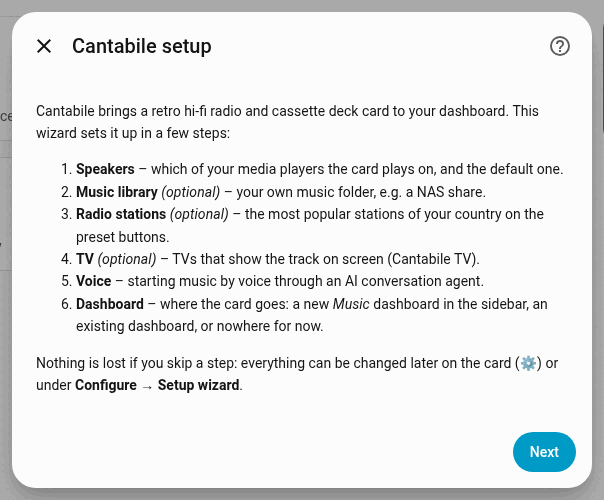
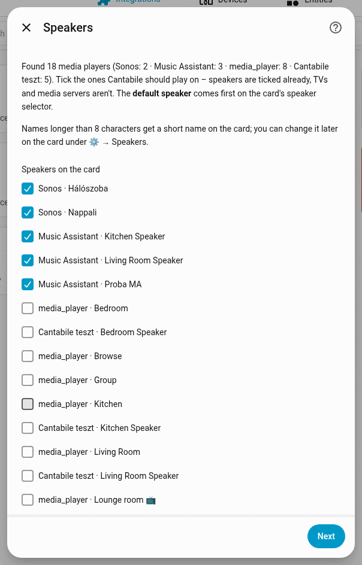
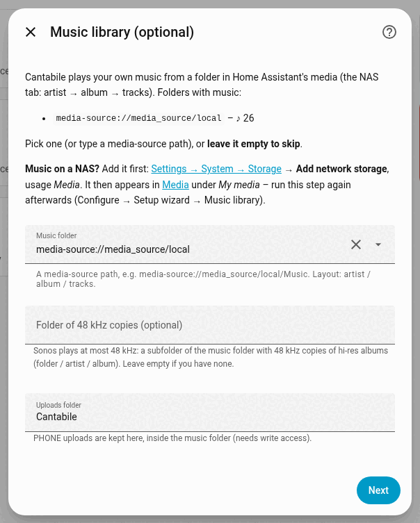
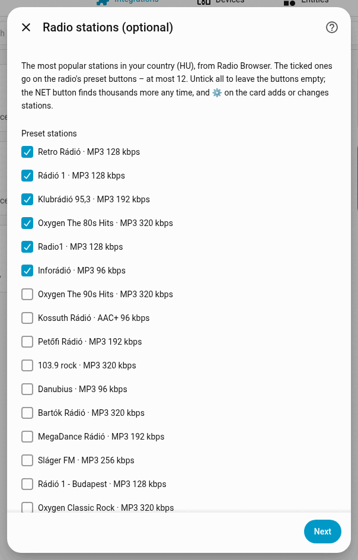
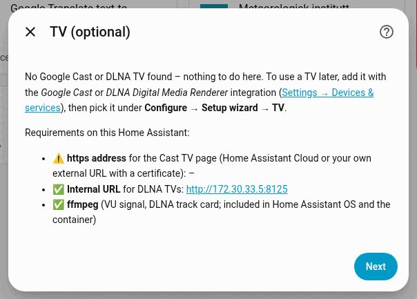
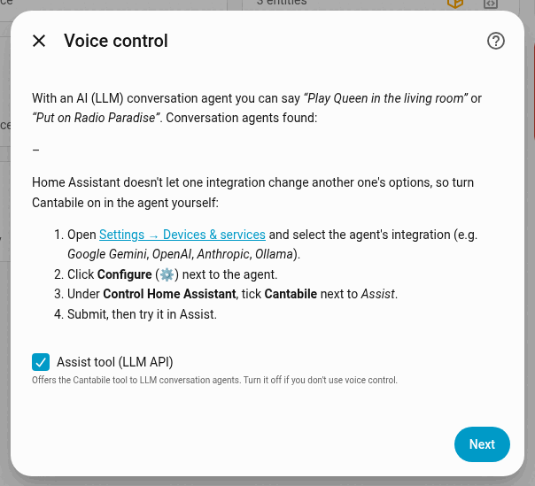
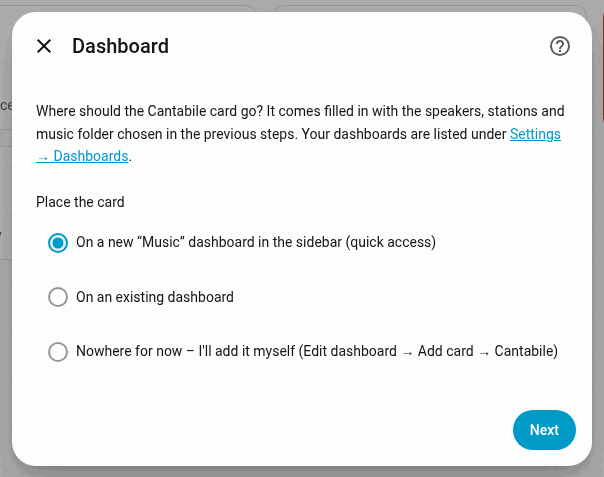
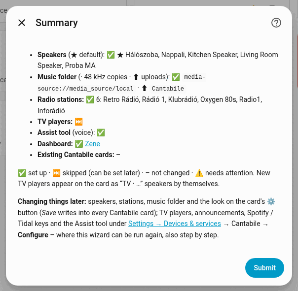

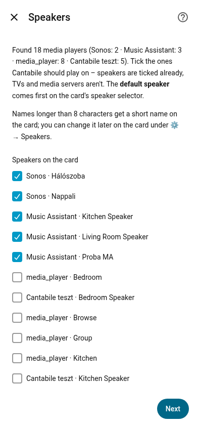 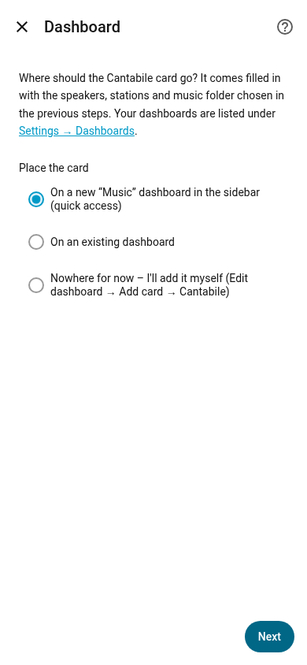 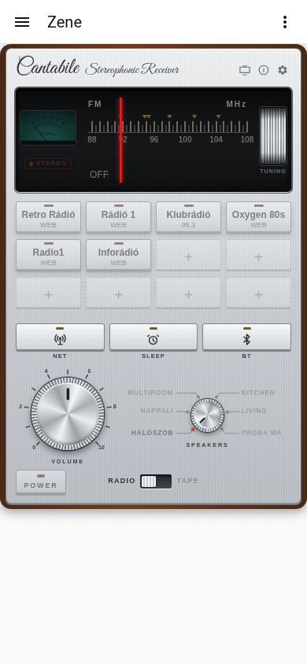

**Running it again:** *Settings → Devices & services → Cantabile → Configure → **Setup wizard*** – the whole wizard from
the start, or a single step (speakers, music library, radio, TV, voice, dashboard). *Save and finish* writes the speakers,
stations and music folder into your Cantabile cards the same way the card's ⚙ *Save* does (every card set up like the
first one, in its own Hungarian or English keys; other cards and settings stay as they are). The old options form
(announcements, TV players, Spotify / Tidal keys, Assist tool) is under *Configure → Settings*.

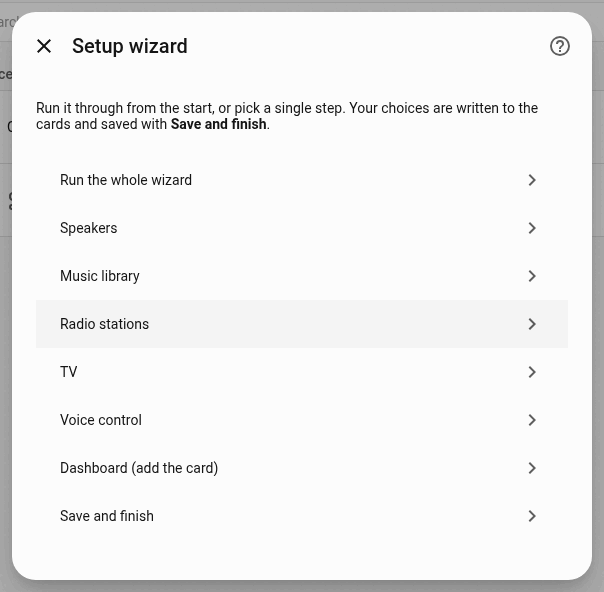

Upgrading from 2.5 or earlier doesn't start the wizard and doesn't change your cards or options.

### Manual setup
1. Add the integration (you can skip every wizard step).
2. Add the card to a dashboard: **Edit dashboard → Add card → Cantabile** (or a *Manual* card with
   `type: custom:cantabile-card`). If “Cantabile” is missing from the card picker, hard-refresh the browser (Ctrl+F5, or
   reload in the companion app) after the restart.
3. Open **⚙** on the card to set the speakers, stations and the music folder. *Save* writes the settings into every
   Cantabile card on all your dashboards, so the tablet and the phone stay identical.

### Voice control
Open your conversation agent's options (e.g. **Google Gemini → Configure**) and turn on **Cantabile** next to *Assist*
under *Control Home Assistant* – the wizard's *Voice* step lists your agents and shows the same steps.

### TV players (Cantabile TV)
1. **Settings → Devices & services → Cantabile → Configure → Setup wizard → TV** (or *Configure → Settings → TV
   players*): pick the TVs. The wizard also creates the `cantabile-tv` dashboard of step 2 and adds the TV players to the
   card (step 3). A Cast device (integration
   *Google Cast*) gets the live TV page, a DLNA TV (integration *DLNA Digital Media Renderer*) the still track card.
   Each becomes a `media_player` called “Cantabile TV · …”.
2. **For Cast TVs only**, create the TV page once: **Settings → Dashboards → Add dashboard → New dashboard from
   scratch**, title *Cantabile TV*, URL **`cantabile-tv`** (no need to show it in the sidebar); open it → ✎ → ⋮ →
   *Raw configuration editor* and paste:
   ```yaml
   views:
     - title: TV
       path: tv
       panel: true
       cards:
         - type: custom:cantabile-tv
   ```
   Optional: `weather: weather.your_entity` on the `cantabile-tv` card shows the current weather (icon and temperature)
   before the clock; without it `weather.home` or the first weather entity is used, `weather: false` hides it.
   `visual:` sets the look – `cover` (default: the cover, the details beside it, the lyrics across the bottom), `vinyl`
   (a spinning record with the cover as its label and a circular spectrum), `bars`, `wave` or `both` (the equaliser);
   `lyrics: false` hides the lyrics. These two keys are only a fallback: the look is normally set in ⚙ → *TV look* or
   with the `select` / `switch` entities below, stored by the integration, and every TV page follows it live.
   The TV loads this page through Home Assistant's Cast receiver, so Home Assistant must be reachable from the TV over
   https (Home Assistant Cloud or your own external URL).
3. On the card: **⚙ → Speakers → + New speaker** → choose the **“Cantabile TV · …”** player (not the TV's own Cast /
   DLNA player – that would only get the sound; the card warns about it).

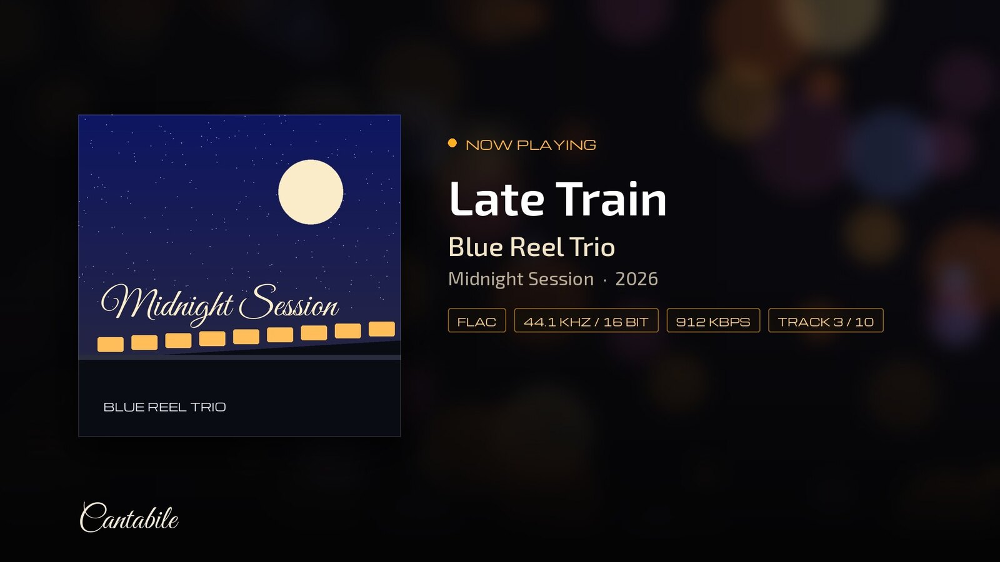

**Cast settings and requirements**
- The TV loads the page through Home Assistant's Cast receiver (`cast.home-assistant.io`), which connects to Home Assistant
  over **https** – Home Assistant Cloud (remote UI) or your own external URL with a valid certificate. A plain `http://`
  LAN address is not enough.
- If you set `http: cors_allowed_origins:` yourself, keep `https://cast.home-assistant.io` in the list (it is there by default).
- If your dashboard resources are in YAML mode, add `/cantabile_static/cantabile-card.js` as a *module* resource: the Cast
  receiver loads only dashboard resources, so without it the TV shows “Custom element doesn't exist”.
- Android TV / Google TV: set the screensaver (and sleep) to *Never*, otherwise the TV leaves the page after ~15 minutes.
- Don't let other automations cast to the same TV while it plays (they would replace the page).
- If the Home Assistant app still runs on the TV but lost its connection (e.g. after a restart), Cantabile closes it and casts again.
- **Mirror**: by hand with **SEND TO TV** / **MIRROR OFF** in the card's TV window (websocket `cantabile/tv/mirror`). And when you switch the card from a playing Cast TV to another speaker (with the selector, by moving the music, or with a ▶ button in a “doesn't play here” message), the TV page stays on, without sound, and shows what plays there – title, artist, album, cover, where it plays and where it comes from (e.g. “▶ SONOS 2 · DEEZER”), the rotating artist pictures and the progress, updated on every new track, wherever the music comes from (music folder, Deezer, radio…). The equaliser follows the real signal level where Cantabile can analyse it, otherwise it is simulated. Switching on to yet another speaker takes the TV along. The mirror ends when you play on the TV again, turn the TV off from the card, or after 10 minutes of silence; then the TV may go to its screensaver.

**DLNA settings and requirements**
- The TV must be **on** (most TVs drop off DLNA in standby) – turn it on first, e.g. with a script or Wake-on-LAN.
- Home Assistant's **internal URL** (Settings → System → Network) must be reachable from the TV; the TV fetches the video
  from there without logging in (signed, time-limited links).
- Each track is turned into a short-lived MP4 (the track card as a still picture + the music as AAC 256 kbps) under
  `config/.cache/cantabile_tv` – about 7 s per track, the next album track is prepared in the background, the cache is
  kept under ~1.5 GB. Radio runs as a live MPEG-TS video.
- Seeking is not available on these videos; next / previous track work.

- The TV plays the music folder, radio, NET stations and PHONE music on the TV page; Deezer and the Sonos favourites from the music folder (when the tracks are there), a long list on the TV's own Music Assistant player (sound only). Tidal stays on Sonos.
- DLNA: about 7 s preparation per track (on albums the next one is prepared in the background), sound as AAC 256 kbps,
  no seeking; radio runs as a live video. Cast: the sound is the original file / stream.
- Cast TV page background: it changes every 30 s with a slow fade and zoom – the artist's fanart from TheAudioDB (free,
  no key needed), plus Kodi-style images in the album or artist folder (`fanart.jpg`, `backdrop2.png`, `extrafanart/…`);
  without them, the artist picture or the cover.
- Next / previous track work from the card, Home Assistant's controls and by voice.

## Adding your own speakers and sources

- **Speakers**: card ⚙ → *Speakers* → **+ New speaker** → pick the player. Only players that can play media are listed;
  the type (Sonos / other) is set automatically. The *card name* (max. 8 characters, needed when the full name is longer) is
  what the card shows – on the rotary selector, the header and the cassette; voice control uses the full name. With two or more Sonos speakers a *Multiroom* position appears (Sonos grouping).
- **Radio stations**: ⚙ → search the Radio Browser by name, or add a name and stream URL by hand. The frequency is
  optional (it only places the station on the dial). On the radio, tap an empty **+** slot or **NET** to browse thousands
  of stations and put one on a button.
- **Your music folder**: add the folder to Home Assistant's media first (Settings → System → Storage → *Add network
  storage* for a NAS, type *Media*), then ⚙ → *Music folder*: the media-source path, e.g.
  `media-source://media_source/local/Music` (open **Media** in the sidebar to see the path). Expected layout:
  artist / album / tracks. A Jellyfin or DLNA-server library works too: use its media-source path.
- **Streaming**: on Sonos, your Sonos favourites (playlists, albums) and the whole Deezer catalogue (with the Deezer
  account linked in the Sonos app). Hide the DEEZER tab in ⚙ if you don't use it.
- **Spotify (experimental)**: set up the Home Assistant **Spotify** integration (your own playlists and library, plus
  playback on Spotify Connect speakers – Premium), and/or enter a Spotify developer key (client ID / secret from
  developer.spotify.com) in the Cantabile integration options for catalogue search. On Sonos it plays with Spotify linked
  in the Sonos app. If a speaker isn't found among the Spotify Connect devices, set `spotify_device: <name>` on it.
- **Tidal (experimental)**: enter a Tidal developer key (developer.tidal.com) in the Cantabile options; playback on Sonos
  with Tidal linked in the Sonos app.
- **Music on your phone / computer**: PHONE tab → *Choose music*. On BT it plays directly; on any other speaker it is
  uploaded temporarily (TEMP on the tape, deleted after 24 hours).
- **Voice**: an LLM conversation agent with the *Cantabile* tool turned on (see Voice control).
- **Announcements**: integration options → announcers (Assist satellites, TTS media players) and the music volume during
  announcements; the music on the Cantabile speakers is turned down while they speak.

## Troubleshooting

| Symptom | Cause / fix |
|---|---|
| “Custom element doesn't exist” | Resources in YAML mode: add `/cantabile_static/cantabile-card.js` as a *module* resource. |
| ⚙ *Save* fails | Needs an administrator and a UI-managed dashboard; with YAML dashboards edit the YAML. |
| A player isn't in the list / can't be selected | It has no *play media* function. |
| Deezer doesn't start | Link Deezer in the Sonos app, or hide the DEEZER tab. |
| A station plays on Sonos but not on BT | Try the http variant of the stream URL; BT radio goes through the integration (`/api/cantabile/stream`). |
| VU meters only “simulate” | No `ffmpeg` on the host, or an encrypted stream (Deezer). |
| Voice: the agent says it can't play music, or “Tool … not found” in the Assist debug | Turn on *Cantabile* in the agent's options. If your own agent prompt names the tool, use its exact name – with Assist also on it is `cantabile__cantabile_play`. |
| A TV only plays the sound (e.g. “Default Media Receiver” on screen) | The card uses the TV's own Cast / DLNA player: switch the speaker to its “Cantabile TV · …” player (⚙ shows a *Switch* button). |
| The Cast TV shows nothing / “dashboard not found” | Create the `cantabile-tv` dashboard with the `tv` view (see *TV players*), and check that Home Assistant is reachable from the TV over https. |
| Music folder is empty | Check the media-source path in ⚙ and that the folder is visible under **Media**. |
| A FLAC track on a TV hiccups once, then plays | The TV page can't open that FLAC; Cantabile plays it as MP3 (seeking works) and remembers the TV (also after a restart). To forget: websocket `cantabile/matrix/reset` with `learned: true`. |
| The room's TV doesn't show what plays in the room | Not a fault: the mirror is sent by hand – **SEND TO TV** in the card's TV window (**MIRROR OFF** ends it). DLNA TVs can't mirror. |
| The selector bounced back to the old speaker, or you wonder why a route was taken | Read the card's decision log: websocket `cantabile/log/get` (last 300 entries); warnings and errors are also in the HA log (`custom_components.cantabile.kartya`). |
| A fix doesn't show in the HA app on a phone / tablet | The app may keep the old card code after a restart: check the version in the card's bottom-right corner; if it is older, close the app completely (or clear its cache) and reopen it. |
| Deezer favourites moved from Sonos to the WiiM play through Music Assistant, not the WiiM's own Deezer | Not a fault: Sonos gives the favourites in reverse order (newest first); when the WiiM would continue with another track, the list goes on through Music Assistant in the Sonos order. |
| GENRES shows only Deezer tiles | The music files have no genre tags, or the first reading is still running (the tab shows the progress). |
| The PARTY QR code doesn't open on a phone | The phone must be on the home Wi-Fi, and Home Assistant's *internal URL* must be set (Settings → System → Network). |
| A playlist plays only some tracks | Each speaker plays what it can: Sonos the music folder and Deezer, a Music Assistant player the MA tracks, others the music folder. |

## Card configuration (YAML)

The card editor (✎ on the dashboard) sets the speakers, brand, front panel, display, music folder and FM band without YAML; stations, speaker names and the short names on the card are set with the card's own ⚙ button. The full YAML:

```yaml
type: custom:cantabile-card
brand: Cantabile                 # optional
finish: silver                   # silver (brushed aluminium) | black (nineties black brushed front)
fm_band: jp                      # optional: jp = Japanese FM band 76–95 MHz (automatic when Home Assistant's country is Japan)
bt: true                         # BT output on this device; false = hidden
speakers:
  - name: Living room            # full name – voice control uses this
    short: Sonos 1               # name shown on the card, max. 8 characters (needed when the name is longer)
    entity: media_player.living_room
    mode: sonos                  # sonos | url (players without a queue, e.g. WiiM)
  - name: WiiM
    entity: media_player.wiim_mini
    mode: url
stations:                        # optional – NET finds more
  - name: Radio Paradise
    short: Paradise              # text on the button
    frequency: 94.8              # position on the dial (87.5–108; Japan 76–95)
    url: http://stream.radioparadise.com/mp3-192
tape:
  media_folder: media-source://media_source/local/Music   # artist/album/track
  hires_folder: Hi-Res 48kHz     # optional: 48 kHz copies for Sonos (<folder>/<artist>/<album [48kHz]>)
  upload_folder: Cantabile       # PHONE uploads go here (inside the music folder)
  display: vu                    # vu (moving-coil meters) | vfd (fluorescent display)
  vu_delay: 0                    # seconds; delays the real VU signal to match the speaker's buffer
deezer: true                     # false hides the DEEZER tab
multiroom: true                  # with two or more Sonos speakers: a “Both” position
```

The earlier Hungarian keys (`hangszorok`, `adok`, `magno`, `nas` …) are accepted as well; ⚙ Save writes back in the same form.

## Entities and services

| Entity | Purpose |
|---|---|
| `number.cantabile_repeat_rounds` | REPEAT: 1–5 rounds, 6 = endless |
| `sensor.cantabile_sleep_timer` | Running sleep timers (`timers` attribute: player → stop time) |
| `sensor.cantabile_voice_started_station` | The internet station started by voice, so the card recognises it |
| `select.cantabile_tv_look` | The look of the TV page: cover, spinning vinyl, equaliser bars, waveform, bars and waveform |
| `switch.cantabile_tv_lyrics` | Running lyrics on the TV page |

| Service | Purpose |
|---|---|
| `cantabile.play` | Play by name (artist, album, track, station, playlist); returns what plays and where |
| `cantabile.play_tracks` / `cantabile.stop_tracks` | Track-by-track playback on players without a queue |
| `cantabile.sleep_timer` | Stop a player after N minutes (fade-out in the last 30 s; Sonos uses its own timer) |

## Automations and examples

Every music action is also a Home Assistant action, so automations, scripts and other systems can start music by
name, the same way as the card or voice: `cantabile.play` with `query`, `kind`, `artist`, `speaker`, `shuffle` and
`source`, answering what plays and where (`success` / `error`). `speaker` may be the name in the card settings, the
short name on the card's selector (e.g. "Sonos 2"), the entity id or the player's name. Ready-to-paste examples – morning radio, wake-up
getting louder, sleep timer, error handling, a button, a script with fields, webhook, MQTT, REST and Python – are in
the [examples](examples/) folder.

**Blueprint – music at a set time** (*Cantabile: zene időpontra*): time, days, only if someone is home, what to
play, speaker, volume, gradually louder, sleep timer and a message if it didn't start.

[](https://my.home-assistant.io/redirect/blueprint_import/?blueprint_url=https%3A%2F%2Fgithub.com%2FGyuszko55%2Fha-cantabile%2Fblob%2Fmain%2Fblueprints%2Fautomation%2Fcantabile%2Fzene_idopontra.yaml)

## Notes

- **Real VU signal** uses `ffmpeg` on the Home Assistant host (included in Home Assistant OS). Encrypted streams
  (e.g. Deezer) can't be analysed – the meters switch to a realistic simulation.
- Sonos decodes at most 48 kHz: with `hires_folder` set, Cantabile plays the 48 kHz copy of a hi-res album on Sonos
  automatically, and the original on other players.
- File names containing `..` can't be played by Home Assistant's media source; Cantabile skips them.
- **Speakers**: any `media_player` that can play media (Sonos, WiiM, Cast, DLNA, Music Assistant, Squeezebox…). `mode` is optional – Sonos is detected automatically; players without a play-media function can't be selected. A `short` name keeps the rotary selector tidy.
- **Stations**: `frequency` is optional; internet-only stations are spread on the dial and show WEB.
- **Deezer** needs the Deezer account linked in the Sonos app; without it, hide the tab (`deezer: false` or ⚙).
- **Saving in ⚙** needs an administrator and a UI-managed dashboard; with YAML dashboards edit the YAML (and add `/cantabile_static/cantabile-card.js` as a module resource if your resources are in YAML mode). Uploading to / clearing the music folder also needs an administrator; the temporary upload works for every user.
- **Speaker lock (several users)**: a speaker belongs to the user who started music on it from a Cantabile card
  (or by voice, when the voice request comes from a logged-in user). On the other users' cards it is dimmed in the selector
  with a slowly blinking lamp and can't be selected; commands to it are refused, and the card says who is using it
  (“Living room is in use: Anna · phone is using it.”). The same user can carry on from another device. The speaker is
  released on STOP, POWER or switching to another speaker, or when it has been silent (paused, stopped, off) for
  5 minutes. An administrator can take it over with **Take over** in the message; the previous user's card is told.
  Voice requests (`cantabile.play`, the Assist tool) don't take a speaker someone else is using. The BT output is never
  locked. Locks live in memory: after a Home Assistant restart every speaker is free.
- **Security**: the BT radio proxy (`/api/cantabile/stream`) and the temporary upload (`/api/cantabile/upload`) need a logged-in user; the proxy only passes audio, the upload folder is capped at 2 GB and cleared after 24 hours.
  The PARTY guest page (`/api/cantabile/party/<token>`) needs no login: it is protected by its random link, works only while the party runs (and guests are on), and can only show what plays, search the music folder and add requests (3 per guest, 30 in all). *GUESTS: OFF* makes the old link invalid.
- **Playlists and the party** live on the server: playlists are kept in Home Assistant's storage (`cantabile_listak`), a party ends with a Home Assistant restart.
- Radio Browser, Deezer and LRCLIB are public directories; Cantabile sends them only your search terms (for lyrics:
  artist, title, album and length of the song). Lyrics are saved as `.lrc` files beside the music-folder tracks and in
  `.cache/cantabile_dalszoveg` on the server for streamed tracks; the background collector respects LRCLIB's rate limit.

## Licence

MIT – see [LICENSE](LICENSE). The bundled *Arimo*, *Great Vibes*, *Michroma* and *Exo 2* fonts are under the SIL Open Font License 1.1 (see the OFL-*.txt files in `www` and `fonts`).
