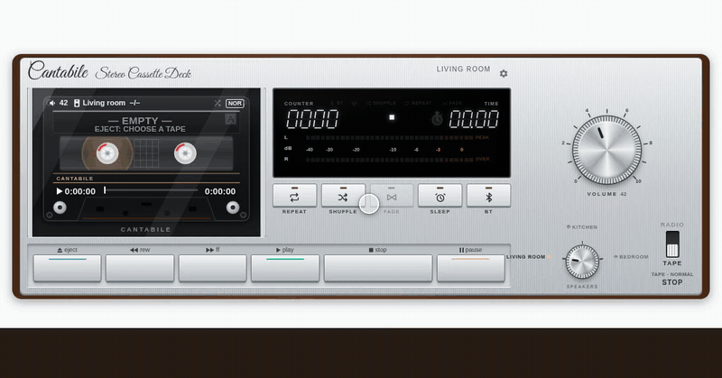
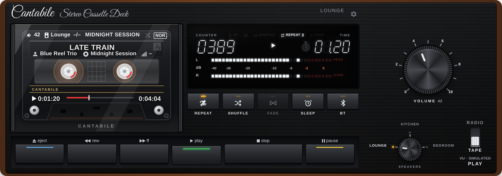
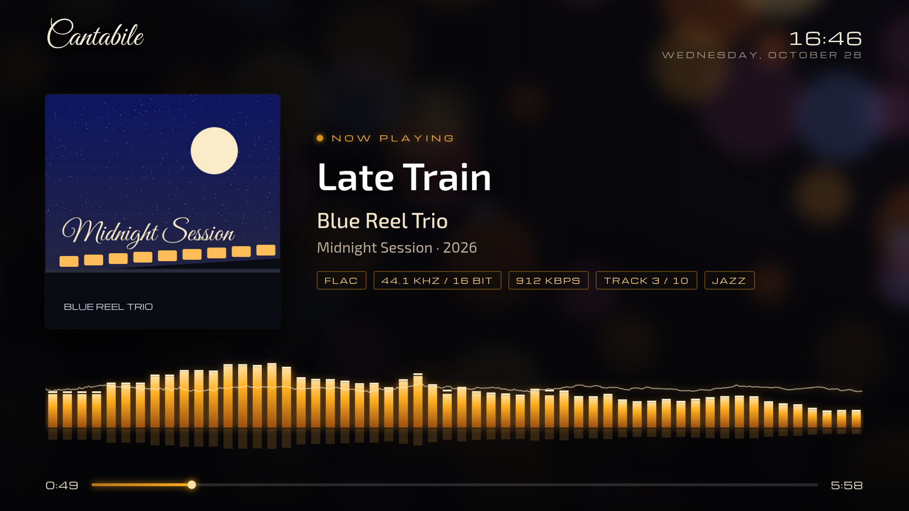
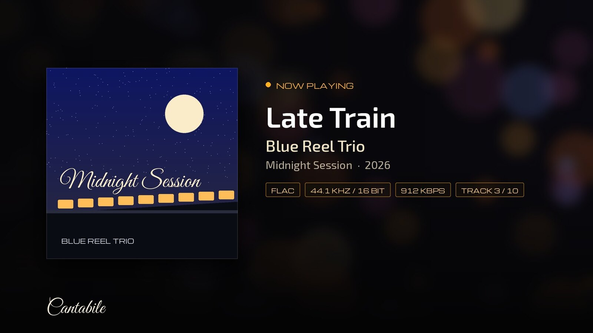

# Cantabile

**An old hi-fi radio and cassette deck – brushed silver or nineties black – for your Home Assistant dashboard** – preset buttons on an FM dial,
internet radio, a cassette deck with turning reels and real VU meters, your own music folder, Deezer, Spotify and Tidal, and voice control.

*Magyar leírás: [README.hu.md](README.hu.md)*






<p align="center"></p>

## What you get

**Radio**
- FM-style glass dial with a moving pointer, preset buttons, a volume knob and a tuning wheel.
- **NET**: thousands of internet stations from the [Radio Browser](https://www.radio-browser.info) directory
  (your country, worldwide, by genre, by name). Any station can be put on a preset button.
- The tuning wheel steps to the next / previous station of a Radio Browser list (the NET list you last played from, or
  your country's), starting from the station that plays; it starts when you
  stop turning. Like it? A long press on a preset button saves it there – also over an older station (with Undo).
- SIGNAL meter that follows the real stream bitrate.

**Cassette deck**
- Cassette window with turning reels, two moving-coil VU meters *or* a fluorescent (VFD) display.
- The VU meters show the **real audio level**: the integration analyses the same stream or file on the server.
- REW / PLAY / FF / STOP / PAUSE / EJECT, SHUFFLE, REPEAT (1–5 rounds or endless), FADE (Sonos crossfade), SLEEP.
- The tape shelf (EJECT):
  - **GENRE** – the music folder's albums by genre, from the music files' own genre tags (read once per album in the background, then kept; the tab shows the progress the first time); tap a genre, then an album;
  - **SEARCH** – one search over every source: music folder, Deezer, Spotify, WiiM presets, Sonos favourites and radio stations; the same album from several sources is one row with source tags, and a tap plays it from the best source for the chosen speaker (or says which speakers can play it). Every search box (also NET and ⚙ stations) has a 🎤 button for **voice search**: speak, and the recognised text is searched straight away. It uses the speech-to-text of your default Assist voice assistant, or the browser's own recogniser if there is none; the microphone needs https. A recogniser set to your language may spell foreign artist names phonetically – correct the text in the box;
  - **STREAMING** – your Sonos favourites (playlists and albums);
  - **DEEZER** – the whole Deezer catalogue: charts, search, artist pages (Sonos only);
  - **WIIM** – the WiiM's presets: anything saved as a preset in the WiiM Home app (Tidal, Qobuz, Amazon Music, Deezer, radio…) plays from Cantabile on the WiiM;
  - **NAS** – your music folder (artist → album), with instant search;
  - **PHONE** – music from the phone / computer: on BT directly, on any other speaker via a temporary upload (TEMP on the tape, deleted after 24 h); or upload it to the music folder for good;
  - **QUEUE** – the current queue: jump, remove, play next, add to end (Sonos).
- **QUEUE reorder**: drag a track by its handle (⋮⋮) – Sonos, WiiM and BT.
- **Gapless**: Sonos (its own queue) and WiiM (the next track is handed over in advance via DLNA); near-gapless on BT.
- **Announcements**: music is turned down while Assist (e.g. Voice PE) or a TTS message speaks (Cantabile options).
- **After a Home Assistant restart** a playing music-folder queue on Sonos continues by itself after the current track.
- **LYRICS**: tap the song title on the cassette (or the radio's now-playing line when it shows a song) – the lyrics
  come from [LRCLIB](https://lrclib.net); on the tape the current line is highlighted and follows the music.

**Look**
- Two front panels: brushed **silver** (old hi-fi) or finely brushed **black** (1990s) with black keys and knobs –
  ⚙ → *Front panel*, or `finish: black` in YAML.
- Each speaker has a **card name** of up to 8 characters (e.g. *Lounge*): it goes on the rotary selector, the header and
  the cassette, while voice control keeps using the full name.
- **Music Assistant (optional)**: if Music Assistant is set up in Home Assistant, the tape shelf has an **MA** tab –
  search and library (albums, artists, playlists, tracks, radio) with covers; it plays on a Music Assistant player with
  MA's own queue (QUEUE shows the current and next track), and switching between MA players moves the queue.
- **ⓘ Signal path**: the button before ⚙ shows, live, where the sound comes from, what happens to it and where it plays
  (source → processing → output, with the EQ / tone and whether the VU meter is real).
- **Messages on the player**: hints and errors appear in a smoked-glass window on the card itself, then fade out
  (tap to close); when the card isn't visible, Home Assistant's own notification is used.

**Speakers**
- Sonos (full feature set, including grouping as “Both”), and any other media player that can play a URL
  (e.g. WiiM – albums are played track by track by the integration).
- **BT**: play on the device the card is open on (headphones, Bluetooth speaker).
- Switching speakers carries the music over, like a real speaker selector.
- **INPUT · TONE** – the flip-down lower panel (the tab at the bottom of either front panel), like the hinged flap of
  an old hi-fi: the speaker's own **inputs** (e.g. NET · BT IN · LINE IN on a WiiM) and **BASS / TREBLE** knobs (−10…+10).
  Sonos uses its own bass / treble; a WiiM its 10-band EQ (BASS: 31–250 Hz, TREBLE: 2–16 kHz; both at 0 turns the EQ off).
  The volume is kept when the input changes (a WiiM remembers a separate volume per input), and starting music from the
  card switches the speaker back to the network. The panel closes with CLOSE, or by itself after 20 s without a touch.
  It appears only on speakers that have something to set; inputs and tone respect the speaker lock.
  While a speaker plays from its own input the tape deck shows the input as the source (“BT IN”) with the title the
  phone sends; the VU meter is simulated there (the sound never passes the server), STOP pauses, and switching to
  another speaker pauses it (switching back resumes).
  > **Bluetooth pairing:** Cantabile doesn't pair or pick the Bluetooth device. Pair and connect your phone / tablet with
  > the speaker in the phone's Bluetooth settings (or the speaker's app, e.g. WiiM Home); BT IN only switches the
  > speaker to its Bluetooth input, and what plays into it is chosen on the phone.
- **PAIR** (next to the inputs, WiiM): switches to BT IN and guides you through connecting the phone / tablet – the
  speaker's Bluetooth name, pairing mode switched on by itself (the light flashes green), an *Open* button for the Bluetooth settings on Android, the known devices and a live
  “✓ Connected” status.
- **EQ** (second tab of the panel, WiiM): a graphic equalizer with ten sliders, the WiiM's built-in sounds and your own
  **profiles** (STORE / DEL, shared by every card), plus **AUTO**: a profile per source (radio, NAS, Deezer, BT IN…) and
  per genre of the music-folder album – it switches when the source or the album changes. BASS / TREBLE and the sliders
  move together. On Sonos the panel has a **LOUDNESS** key instead.

**TV (Cantabile TV)**
- TVs become speakers, with the track on the screen: on **Cast** devices (TV sticks, Android TV boxes, Nest Hub) a
  full-screen TV page – artist image, cover, title, artist, album, format, an equalizer that follows the music and a
  progress bar; on **DLNA** TVs a full-screen still track card. See *TV players* below.



**Voice**
- An Assist tool for any LLM conversation agent (Google Gemini, OpenAI, Anthropic, Ollama…):
  *“Play Queen in the living room”*, *“Put on the Kind of Magic album”*, *“Turn on Jazz FM in the bedroom”*,
  *“Play Adele from Deezer”*, *“Play Daft Punk from Spotify”*. Anything not in your music folder is looked up on Deezer;
  Spotify and Tidal are used when you ask for them (on Sonos).

Front-panel labels are always English, like on a real old hi-fi; settings, messages and tooltips follow your Home Assistant language: **Hungarian** or **English**.

## Requirements and compatibility

- Home Assistant **2025.1** or newer (developed and fully tested on 2026.10; imports and APIs checked on 2025.1).
  Searching non-local music libraries needs a newer HA (the media search API is in 2026.10, not yet in 2025.1);
  browsing them and everything else works on older versions.
- At least one `media_player` that can play media. What you get depends on the player:

| Player (HA integration) | Radio | Music folder | Gapless | Queue tab / drag | Multiroom | Deezer / Sonos favourites |
|---|---|---|---|---|---|---|
| **Sonos** | ✔ | ✔ | ✔ (Sonos queue) | ✔ | ✔ (Sonos only) | ✔ |
| **WiiM**, **LinkPlay** (Arylic, Audio Pro…), **DLNA renderers** | ✔ | ✔ | ✔ (DLNA next-track) | ✔ | – | – |
| **Chromecast / Google Cast**, **Music Assistant**, **Squeezebox**, others with *play media* | ✔ | ✔ (track by track) | – | ✔ | – | – |
| **BT** (the device the card is open on) | ✔ | ✔ | near-gapless | ✔ | – | – |

- Players without a *play media* function (e.g. remote-only TVs, Spotify Connect entities) can't be used and aren't offered.
- Optional: a music folder (a NAS share or local folder in Home Assistant's media, or another media source such as
  Jellyfin or a DLNA media server – browsable, and searchable where Home Assistant has the media search API). Plex is not a media source in Home
  Assistant and can't be used as the music folder.
- Optional: `ffmpeg` on the host for the real VU signal (included in Home Assistant OS and the container image;
  without it the meters show a realistic simulation).
- Deezer playback needs the Deezer service added to your Sonos app. Searching Deezer needs no account.
- Browsers: a current Chrome / Edge, Safari or Firefox – at least Chrome 105, Safari / iOS 16 or Firefox 110 (older
  ones, e.g. an old wall-tablet WebView, may misplace the cassette and display labels). The card has its own look and
  doesn't follow Home Assistant themes.

## What to install – and what Cantabile brings

### Comes with Cantabile (nothing to install)

| Part | Notes |
|---|---|
| The card | Served by the integration and registered as a dashboard resource automatically (YAML-mode resources: add `/cantabile_static/cantabile-card.js` as a *module* yourself). |
| Fonts | *Arimo* (the card's Arial-size sans, so phone font settings don't change the look), *Great Vibes*, *Michroma*, *Exo 2* – bundled and served locally (SIL OFL), nothing is loaded from Google. |
| Python package `async-upnp-client` | Installed by Home Assistant from the manifest (normally already present); used for gapless playback on DLNA / WiiM / LinkPlay. |
| Entities and services | Repeat rounds, sleep timer, voice-started station; `cantabile.play`, `cantabile.sleep_timer` … (see *Entities and services*). |
| Assist tool | The *Cantabile* LLM API for voice control – appears in your conversation agent's options. |
| Free online sources (no account, no key) | [Radio Browser](https://www.radio-browser.info) (stations), the public Deezer catalogue API (search), [LRCLIB](https://lrclib.net) (lyrics). |

### What you install or set up yourself

| What | Needed for | How |
|---|---|---|
| Home Assistant **2025.1+** | everything | – |
| Your speakers' integration | playback | **Settings → Devices & services → Add integration**: *Sonos*, *WiiM*, *LinkPlay*, *DLNA Digital Media Renderer*, *Google Cast*, *Music Assistant*, *Squeezebox*… (Home Assistant's own integrations, not part of Cantabile). |
| `ffmpeg` on the host | the real VU signal (optional) | Included in Home Assistant OS and the container image. On a Python-venv (Core) install, install it with the system package manager. Without it the meters simulate. |
| A music folder | NAS / PHONE tabs (optional) | See *Connecting a music library (NAS)* below. |
| **Cast TV** (Cantabile TV, optional) | the live TV page | A Cast device with a screen (Chromecast / Google TV, Android TV box or stick, Nest Hub) set up with the **Google Cast** integration; Home Assistant reachable from the TV over **https** (Home Assistant Cloud, or your own external URL with a certificate); the `cantabile-tv` dashboard (see *TV players*). |
| **DLNA TV** (Cantabile TV, optional) | the still track card | A TV with a DLNA renderer, set up with the **DLNA Digital Media Renderer** integration; Home Assistant's **internal URL** reachable from the TV over the LAN; `ffmpeg` on the host (it makes the track-card videos – without it the TV gets the music and the cover only); about 1.5 GB of disk for the video cache. |
| A conversation agent | voice control (optional) | E.g. *Google Gemini*, *OpenAI*, *Anthropic*, *Ollama*; then turn on **Cantabile** in its options (see *Voice control*). |
| Streaming accounts / keys | DEEZER, SPOTIFY, TIDAL (optional) | See the next section. |

### Streaming services

| Service | What you need | What you get | Plays on |
|---|---|---|---|
| **Sonos favourites** | Favourites saved in the Sonos app | Your saved playlists, albums and stations on the STREAMING tab, by voice too | Sonos |
| **Deezer** | A Deezer subscription linked in the **Sonos app** (*Settings → Services & voice → Add a service*). Searching needs no account. | Charts, search, artist pages, albums, tracks; voice (*“… from Deezer”*); anything not in your music folder is looked up here | Sonos |
| **Spotify** *(experimental)* | 1. The Home Assistant **Spotify** integration – with your own Spotify developer app; redirect URI `https://my.home-assistant.io/redirect/oauth`; **Premium** for playback. 2. Optional: a Spotify developer key (client ID / secret) in the **Cantabile options** for catalogue search (without it the Spotify integration's session is used). 3. For Sonos: Spotify linked in the Sonos app. | Search, artist pages, albums, your playlists and library; voice (*“… from Spotify”*) | Sonos (link), any **Spotify Connect** speaker (e.g. WiiM) |
| **Tidal** *(experimental)* | A Tidal developer key (developer.tidal.com, client ID / secret) in the Cantabile options; Tidal linked in the Sonos app | Search, artists, albums, playlists; voice (*“… from Tidal”*) | Sonos |

**Watch out**
- Streaming services play on the speaker itself, so the VU meters **simulate** and no bitrate / codec is shown (the speaker doesn't report them).
- Deezer, Tidal and the Sonos favourites are **Sonos only** – choosing another speaker shows a message and keeps the music where it is.
- **Spotify developer apps run in “development mode”** with stricter limits, and Cantabile works within them: 10 search results per type, artist albums 10 at a time, no “top tracks” (a filtered search is used instead), and other people's playlists can be started but not listed track by track.
- Your Spotify library can only be browsed while something is playing on Spotify (a limit of the Home Assistant Spotify player); otherwise the tab asks what to search for.
- Spotify Connect: a speaker may be missing from Spotify's device list until it has played Spotify once – open the Spotify app on it, or set `spotify_device: <name as Spotify shows it>` on the speaker.
- Keys and tokens stay on the server; the card only asks the integration for read-only catalogue calls.
- Tidal support is new and has not been tested with a live account yet.

### Connecting a music library (NAS)

1. On the NAS, share the music folder over **SMB** (or NFS) – read access is enough; write access only if you want to upload from the PHONE tab for good.
2. **Settings → System → Storage → Add network storage**: a name (e.g. `Music`), usage **Media**, protocol, server address, share name, user / password.
3. Open **Media** in the sidebar: the share appears under *My media*. Its path is `media-source://media_source/local/<name>`, e.g. `media-source://media_source/local/Music`.
4. On the card: **⚙ → Music folder** → paste the path → *Save*. The NAS tab now lists artists → albums → tracks.

- Expected layout: `<artist>/<album>/<tracks>` (MP3, FLAC, AAC/M4A, OGG… – whatever your speakers play).
- **Sonos plays at most 48 kHz**: for hi-res albums keep 48 kHz copies in a separate folder and set *Folder of 48 kHz copies* (`hires_folder`); Cantabile picks the copy on Sonos and the original elsewhere.
- PHONE uploads go into the *Uploads folder* (`upload_folder`, default `Cantabile`) inside the music folder – this needs write access and an administrator user.
- The first search scans the folder (cached for 30 minutes); very large libraries take a few seconds.
- A Jellyfin or DLNA-server library works too (its media-source path); Plex is not a media source in Home Assistant.
- File names containing `..` can't be played by Home Assistant's media source and are skipped.

## Installation

### HACS (custom repository)
1. HACS → ⋮ → **Custom repositories** → add `https://github.com/Gyuszko55/ha-cantabile`, category **Integration**.
2. Install **Cantabile**, then restart Home Assistant.

### Manual
Copy `custom_components/cantabile` into your `config/custom_components` folder and restart Home Assistant.

## Setup

1. **Settings → Devices & services → Add integration → Cantabile.** Leave “Assist tool” on if you want voice control.
2. Add the card to a dashboard: **Edit dashboard → Add card → Cantabile** (or a *Manual* card with
   `type: custom:cantabile-card`). The integration serves and registers the card itself – no separate resource is needed.
   > **The card does not appear on its own.** The integration creates the entities and makes the card available, but you
   > have to add it to a dashboard yourself. If “Cantabile” is missing from the card picker, hard-refresh the browser
   > (Ctrl+F5, or reload in the companion app) after the restart. With YAML-mode resources, add
   > `/cantabile_static/cantabile-card.js` as a *module* resource.
3. Open **⚙** on the card to set the speakers, stations and the music folder. *Save* writes the settings into every
   Cantabile card on all your dashboards, so the tablet and the phone stay identical.

### Voice control
After setting up the integration, open your conversation agent's options (e.g. **Google Gemini → Configure**) and turn on
**Cantabile** next to *Assist* under *Control Home Assistant*.

### TV players (Cantabile TV)
1. **Settings → Devices & services → Cantabile → Configure → TV players**: pick the TVs. A Cast device (integration
   *Google Cast*) gets the live TV page, a DLNA TV (integration *DLNA Digital Media Renderer*) the still track card.
   Each becomes a `media_player` called “Cantabile TV · …”.
2. **For Cast TVs only**, create the TV page once: **Settings → Dashboards → Add dashboard → New dashboard from
   scratch**, title *Cantabile TV*, URL **`cantabile-tv`** (no need to show it in the sidebar); open it → ✎ → ⋮ →
   *Raw configuration editor* and paste:
   ```yaml
   views:
     - title: TV
       path: tv
       panel: true
       cards:
         - type: custom:cantabile-tv
   ```
   The TV loads this page through Home Assistant's Cast receiver, so Home Assistant must be reachable from the TV over
   https (Home Assistant Cloud or your own external URL).
3. On the card: **⚙ → Speakers → + New speaker** → choose the **“Cantabile TV · …”** player (not the TV's own Cast /
   DLNA player – that would only get the sound; the card warns about it).



**Cast settings and requirements**
- The TV loads the page through Home Assistant's Cast receiver (`cast.home-assistant.io`), which connects to Home Assistant
  over **https** – Home Assistant Cloud (remote UI) or your own external URL with a valid certificate. A plain `http://`
  LAN address is not enough.
- If you set `http: cors_allowed_origins:` yourself, keep `https://cast.home-assistant.io` in the list (it is there by default).
- If your dashboard resources are in YAML mode, add `/cantabile_static/cantabile-card.js` as a *module* resource: the Cast
  receiver loads only dashboard resources, so without it the TV shows “Custom element doesn't exist”.
- Android TV / Google TV: set the screensaver (and sleep) to *Never*, otherwise the TV leaves the page after ~15 minutes.
- Don't let other automations cast to the same TV while it plays (they would replace the page).
- If the Home Assistant app still runs on the TV but lost its connection (e.g. after a restart), Cantabile closes it and casts again.
- **Mirror**: when you switch the card from a playing Cast TV to another speaker (with the selector, by moving the music, or with a ▶ button in a “doesn't play here” message), the TV page stays on, without sound, and shows what plays there – title, artist, album, cover, where it plays and where it comes from (e.g. “▶ SONOS 2 · DEEZER”), the rotating artist pictures and the progress, updated on every new track, wherever the music comes from (music folder, Deezer, radio…). The equaliser follows the real signal level where Cantabile can analyse it, otherwise it is simulated. Switching on to yet another speaker takes the TV along. The mirror ends when you play on the TV again, turn the TV off from the card, or after 10 minutes of silence; then the TV may go to its screensaver.

**DLNA settings and requirements**
- The TV must be **on** (most TVs drop off DLNA in standby) – turn it on first, e.g. with a script or Wake-on-LAN.
- Home Assistant's **internal URL** (Settings → System → Network) must be reachable from the TV; the TV fetches the video
  from there without logging in (signed, time-limited links).
- Each track is turned into a short-lived MP4 (the track card as a still picture + the music as AAC 256 kbps) under
  `config/.cache/cantabile_tv` – about 7 s per track, the next album track is prepared in the background, the cache is
  kept under ~1.5 GB. Radio runs as a live MPEG-TS video.
- Seeking is not available on these videos; next / previous track work.

- The TV plays the music folder, radio, NET stations and PHONE music; Deezer, Tidal and the Sonos favourites stay on Sonos.
- DLNA: about 7 s preparation per track (on albums the next one is prepared in the background), sound as AAC 256 kbps,
  no seeking; radio runs as a live video. Cast: the sound is the original file / stream.
- Cast TV page background: it changes every 30 s with a slow fade and zoom – the artist's fanart from TheAudioDB (free,
  no key needed), plus Kodi-style images in the album or artist folder (`fanart.jpg`, `backdrop2.png`, `extrafanart/…`);
  without them, the artist picture or the cover.
- Next / previous track work from the card, Home Assistant's controls and by voice.

## Adding your own speakers and sources

- **Speakers**: card ⚙ → *Speakers* → **+ New speaker** → pick the player. Only players that can play media are listed;
  the type (Sonos / other) is set automatically. The *card name* (max. 8 characters, needed when the full name is longer) is
  what the card shows – on the rotary selector, the header and the cassette; voice control uses the full name. With two or more Sonos speakers a *Multiroom* position appears (Sonos grouping).
- **Radio stations**: ⚙ → search the Radio Browser by name, or add a name and stream URL by hand. The frequency is
  optional (it only places the station on the dial). On the radio, tap an empty **+** slot or **NET** to browse thousands
  of stations and put one on a button.
- **Your music folder**: add the folder to Home Assistant's media first (Settings → System → Storage → *Add network
  storage* for a NAS, type *Media*), then ⚙ → *Music folder*: the media-source path, e.g.
  `media-source://media_source/local/Music` (open **Media** in the sidebar to see the path). Expected layout:
  artist / album / tracks. A Jellyfin or DLNA-server library works too: use its media-source path.
- **Streaming**: on Sonos, your Sonos favourites (playlists, albums) and the whole Deezer catalogue (with the Deezer
  account linked in the Sonos app). Hide the DEEZER tab in ⚙ if you don't use it.
- **Spotify (experimental)**: set up the Home Assistant **Spotify** integration (your own playlists and library, plus
  playback on Spotify Connect speakers – Premium), and/or enter a Spotify developer key (client ID / secret from
  developer.spotify.com) in the Cantabile integration options for catalogue search. On Sonos it plays with Spotify linked
  in the Sonos app. If a speaker isn't found among the Spotify Connect devices, set `spotify_device: <name>` on it.
- **Tidal (experimental)**: enter a Tidal developer key (developer.tidal.com) in the Cantabile options; playback on Sonos
  with Tidal linked in the Sonos app.
- **Music on your phone / computer**: PHONE tab → *Choose music*. On BT it plays directly; on any other speaker it is
  uploaded temporarily (TEMP on the tape, deleted after 24 hours).
- **Voice**: an LLM conversation agent with the *Cantabile* tool turned on (see Voice control).
- **Announcements**: integration options → announcers (Assist satellites, TTS media players) and the music volume during
  announcements; the music on the Cantabile speakers is turned down while they speak.

## Troubleshooting

| Symptom | Cause / fix |
|---|---|
| “Custom element doesn't exist” | Resources in YAML mode: add `/cantabile_static/cantabile-card.js` as a *module* resource. |
| ⚙ *Save* fails | Needs an administrator and a UI-managed dashboard; with YAML dashboards edit the YAML. |
| A player isn't in the list / can't be selected | It has no *play media* function. |
| Deezer doesn't start | Link Deezer in the Sonos app, or hide the DEEZER tab. |
| A station plays on Sonos but not on BT | Try the http variant of the stream URL; BT radio goes through the integration (`/api/cantabile/stream`). |
| VU meters only “simulate” | No `ffmpeg` on the host, or an encrypted stream (Deezer). |
| Voice: the agent says it can't play music, or “Tool … not found” in the Assist debug | Turn on *Cantabile* in the agent's options. If your own agent prompt names the tool, use its exact name – with Assist also on it is `cantabile__cantabile_play`. |
| A TV only plays the sound (e.g. “Default Media Receiver” on screen) | The card uses the TV's own Cast / DLNA player: switch the speaker to its “Cantabile TV · …” player (⚙ shows a *Switch* button). |
| The Cast TV shows nothing / “dashboard not found” | Create the `cantabile-tv` dashboard with the `tv` view (see *TV players*), and check that Home Assistant is reachable from the TV over https. |
| Music folder is empty | Check the media-source path in ⚙ and that the folder is visible under **Media**. |

## Card configuration (YAML)

The card editor (✎ on the dashboard) sets the speakers, brand, front panel, display, music folder and FM band without YAML; stations, speaker names and the short names on the card are set with the card's own ⚙ button. The full YAML:

```yaml
type: custom:cantabile-card
brand: Cantabile                 # optional
finish: silver                   # silver (brushed aluminium) | black (nineties black brushed front)
fm_band: jp                      # optional: jp = Japanese FM band 76–95 MHz (automatic when Home Assistant's country is Japan)
bt: true                         # BT output on this device; false = hidden
speakers:
  - name: Living room            # full name – voice control uses this
    short: Sonos 1               # name shown on the card, max. 8 characters (needed when the name is longer)
    entity: media_player.living_room
    mode: sonos                  # sonos | url (players without a queue, e.g. WiiM)
  - name: WiiM
    entity: media_player.wiim_mini
    mode: url
stations:                        # optional – NET finds more
  - name: Radio Paradise
    short: Paradise              # text on the button
    frequency: 94.8              # position on the dial (87.5–108; Japan 76–95)
    url: http://stream.radioparadise.com/mp3-192
tape:
  media_folder: media-source://media_source/local/Music   # artist/album/track
  hires_folder: Hi-Res 48kHz     # optional: 48 kHz copies for Sonos (<folder>/<artist>/<album [48kHz]>)
  upload_folder: Cantabile       # PHONE uploads go here (inside the music folder)
  display: vu                    # vu (moving-coil meters) | vfd (fluorescent display)
  vu_delay: 0                    # seconds; delays the real VU signal to match the speaker's buffer
deezer: true                     # false hides the DEEZER tab
multiroom: true                  # with two or more Sonos speakers: a “Both” position
```

The earlier Hungarian keys (`hangszorok`, `adok`, `magno`, `nas` …) are accepted as well; ⚙ Save writes back in the same form.

## Entities and services

| Entity | Purpose |
|---|---|
| `number.cantabile_repeat_rounds` | REPEAT: 1–5 rounds, 6 = endless |
| `sensor.cantabile_sleep_timer` | Running sleep timers (`timers` attribute: player → stop time) |
| `sensor.cantabile_voice_started_station` | The internet station started by voice, so the card recognises it |

| Service | Purpose |
|---|---|
| `cantabile.play` | Play by name (artist, album, track, station, playlist); returns what plays and where |
| `cantabile.play_tracks` / `cantabile.stop_tracks` | Track-by-track playback on players without a queue |
| `cantabile.sleep_timer` | Stop a player after N minutes (fade-out in the last 30 s; Sonos uses its own timer) |

## Notes

- **Real VU signal** uses `ffmpeg` on the Home Assistant host (included in Home Assistant OS). Encrypted streams
  (e.g. Deezer) can't be analysed – the meters switch to a realistic simulation.
- Sonos decodes at most 48 kHz: with `hires_folder` set, Cantabile plays the 48 kHz copy of a hi-res album on Sonos
  automatically, and the original on other players.
- File names containing `..` can't be played by Home Assistant's media source; Cantabile skips them.
- **Speakers**: any `media_player` that can play media (Sonos, WiiM, Cast, DLNA, Music Assistant, Squeezebox…). `mode` is optional – Sonos is detected automatically; players without a play-media function can't be selected. A `short` name keeps the rotary selector tidy.
- **Stations**: `frequency` is optional; internet-only stations are spread on the dial and show WEB.
- **Deezer** needs the Deezer account linked in the Sonos app; without it, hide the tab (`deezer: false` or ⚙).
- **Saving in ⚙** needs an administrator and a UI-managed dashboard; with YAML dashboards edit the YAML (and add `/cantabile_static/cantabile-card.js` as a module resource if your resources are in YAML mode). Uploading to / clearing the music folder also needs an administrator; the temporary upload works for every user.
- **Speaker lock (several users)**: a speaker belongs to the user who started music on it from a Cantabile card
  (or by voice, when the voice request comes from a logged-in user). On the other users' cards it is dimmed in the selector
  with a slowly blinking lamp and can't be selected; commands to it are refused, and the card says who is using it
  (“Living room is in use: Kata · phone is using it.”). The same user can carry on from another device. The speaker is
  released on STOP, POWER or switching to another speaker, or when it has been silent (paused, stopped, off) for
  5 minutes. An administrator can take it over with **Take over** in the message; the previous user's card is told.
  Voice requests (`cantabile.play`, the Assist tool) don't take a speaker someone else is using. The BT output is never
  locked. Locks live in memory: after a Home Assistant restart every speaker is free.
- **Security**: the BT radio proxy (`/api/cantabile/stream`) and the temporary upload (`/api/cantabile/upload`) need a logged-in user; the proxy only passes audio, the upload folder is capped at 2 GB and cleared after 24 hours.
- Radio Browser, Deezer and LRCLIB are public directories; Cantabile sends them only your search terms (for lyrics:
  artist, title, album and length of the song). Lyrics are cached in memory only.

## Licence

MIT – see [LICENSE](LICENSE). The bundled *Arimo*, *Great Vibes*, *Michroma* and *Exo 2* fonts are under the SIL Open Font License 1.1 (see the OFL-*.txt files in `www` and `fonts`).
